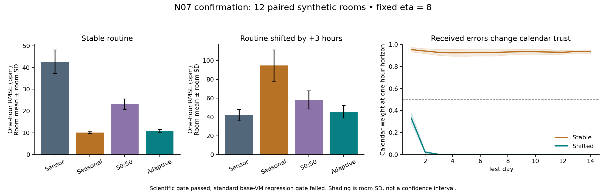

# N07 results: adapt calendar trust using received errors

Material Passport: ANALYZED; computations replayed by the same agent.
Completed 2026-09-29. This is fresh synthetic evidence, separate from frozen
N01–N06 results. Protocol, implementation and gates were fixed before development.

**The narrow scientific gate passed; standard engineering acceptance failed.**
Across stable and shifted routines, the adaptive mixture outperformed all three
fixed controls on the primary balanced one-hour measure. It was slightly worse
than the best specialist within each regime. On the separate standard synthetic
benchmark, both mixtures met absolute accuracy thresholds but exceeded the
allowed regression against base VM. They remain diagnostic/unvalidated under
the repository's acceptance rules. No VM-specific advantage was tested.

## Frozen question and execution

The [prospective protocol](calendar_trust_protocol_v1.md) and
[configuration](../configs/calendar_trust_v1.json) define two development rooms,
12 disjoint confirmation rooms, paired stable/+3-hour shifted routines, the
unchanged N04 generator and residual ridge, and a training-only seasonal table.
Only calendar/sensor mixture weights adapt; expert coefficients remain fixed.
The update uses normalized squared errors after observation receipt, with a
24-update half-life and horizon-specific states. Validation hindcasts initialize
the losses; all initialization and selection information predates test issuance.

Development selected eta **8** from `[0.5, 2, 8]`. Mean development one-hour
normalized RMSE was 0.54051, 0.47378 and 0.43231 respectively. This choice was
frozen before generating confirmation rooms. No formal fit was retried, no
confirmation-based settings were selected, and no gate was weakened.

The target is noisy CO2 in ppm. Chronological splits are 28/14/14 days, with
15-minute sampling and a 15-minute observation delay. The sensor has six hours
of history, hourly forecast origins and 16 future endpoints. Physical attendance
is regular, the event and response time constant are both two hours, and there
are no outages in the scientific campaign. Missing-packet behavior is unit-tested,
not established by this campaign.

Per room: 662 training windows (10,592 label uses, 2,660 unique target times),
326 validation windows and 326 test windows per regime (5,216 label uses and
1,316 unique target times each). Targets across overlapping windows are reused,
not independent observations. The seasonal fit also reads received training
observations outside these target windows. Ridge has 1,168 fitted coefficients,
the seasonal table 96 values and the adaptive mixer 32 loss-state values.
All methods share these component fits and eligible origins. Only the adaptive
method changes weights using received test observations.

## Confirmation results

The primary score averages stable and shifted normalized RMSE within each room.
The table reports mean room-level percentage gain and a percentile 95% bootstrap
interval from 10,000 paired room resamples; individual intervals are descriptive,
not simultaneous confidence bands. All three contrasts must pass the intersection
gate (mean gain >=5%, lower endpoint >0), along with the regime safeguards.

| Comparator | Mean balanced gain | Paired 95% interval | Contrast gate |
| --- | ---: | ---: | --- |
| Sensor-only | 33.41% | [32.58%, 34.21%] | Passed |
| Seasonal-only | 45.93% | [43.71%, 47.96%] | Passed |
| Fixed 50:50 mixture | 30.38% | [28.68%, 31.95%] | Passed |

Stable normalized RMSE was **7.21% worse than seasonal**; shifted normalized
RMSE was **8.25% worse than sensor-only**. Both are inside the preset 10% limits.
Thus the gate supports adaptation across the two regimes, not superiority over
an oracle that knows which expert will be better.

Absolute one-hour errors below are means across rooms; ± is room standard
deviation of RMSE, not a confidence interval. Each room is the statistical unit.

| Method | Stable RMSE, ppm | Stable MAE, ppm | Shifted RMSE, ppm | Shifted MAE, ppm |
| --- | ---: | ---: | ---: | ---: |
| Sensor | 42.75 ± 5.42 | 28.38 | 41.87 ± 6.06 | 27.99 |
| Seasonal | 10.08 ± 0.43 | 8.05 | 94.70 ± 16.67 | 56.39 |
| Fixed 50:50 | 23.14 ± 2.44 | 16.08 | 57.99 ± 9.63 | 37.72 |
| Adaptive | 10.86 ± 0.63 | 8.64 | 45.36 ± 6.67 | 29.35 |

The plots use separate error-axis ranges for the two regimes. Descriptive
calendar weight remained about 0.93–0.95 under stable routines. After the shift,
the room-mean daily weight was 0.329 on day 1, 0.0216 on day 2 and 0.00116 on
day 3. This is a reaction to received prediction errors, not access to a shift flag.
The cost of adaptation is visible: shifted adaptive RMSE averaged 64.71 ppm in
the first 48 hours versus sensor-only's 42.79; later errors were 41.735 versus
41.729 ppm. The method effectively falls back to the sensor after learning that
the old schedule is unreliable; it does not learn the new schedule.

The 15-minute and four-hour endpoints and all early/late diagnostics are retained
in the [compact evidence record](calendar_trust_results_v1.json). They are
diagnostic and do not expand the successful one-hour claim. For example, at
15 minutes stable adaptive RMSE was 12.08 ppm versus seasonal 10.05, so benefits
and tolerances should not be assumed to transfer across horizons.

## Engineering acceptance and checks

The fresh seed-42 standard benchmark used the unchanged 90-day generator,
80/10/10 chronological split, 72-step history, 12-step horizon and 50-epoch
maximum base-VM trainer on CUDA. Training/validation/test windows were
1,645/133/133. The inherited local Europe/Paris calendar and hourly phase
extension are retained, including the test-period DST transition; this is the
existing benchmark contract, not a new time-zone robustness test.

| Method | RMSE ppm | MAE ppm | R2 | MAPE % | Absolute gate | Base regression gate |
| --- | ---: | ---: | ---: | ---: | --- | --- |
| Fresh base VM | 5.3573 | 4.1508 | 0.9790 | 0.6916 | Pass | Reference |
| Sensor ridge | 5.1222 | 3.9787 | 0.9808 | 0.6608 | Pass | Pass |
| Seasonal | 13.2330 | 11.0735 | 0.8716 | 1.8476 | Pass | Diagnostic only |
| Fixed mixture | 7.6289 | 6.1810 | 0.9573 | 1.0309 | Pass | **Fail** |
| Adaptive mixture | 6.2081 | 5.0181 | 0.9717 | 0.8373 | Pass | **Fail** |

The two mixtures failed all three error-regression checks (RMSE, MAE, MAPE),
while R2 regression passed. The absolute thresholds remain RMSE <=35, MAE <=25,
R2 >=0.20 and MAPE <=5%; regression limits remain 10% for errors and 0.10 for R2.
Completed engineering acceptance failure was retained with a nonzero command
exit status. Confirmation remained permissible only as a diagnostic hypothesis
test under the original protocol. Its scientific pass does not override this.

The full suite passed **1,848 tests in 108.97 seconds**, including 46 new tests
covering the mixer, real disposable runner path, bridge and unchanged N06
source adapters. Causality tests mutate unseen truth, exercise absent packets,
zero/delayed arrival, per-horizon state and invalid timing. Bridge bounds were
checked against an independent ODE solver. Confirmation artifact replay matched
all 24 cells and 96 method/regime/room records exactly, with zero future-feedback
violations; engineering predictions and all five metric sets also replayed
exactly. These are software checks and same-agent artifact review, not an
independent scientific replication or peer review.

Development took 1.90 seconds, confirmation 6.64 seconds, and engineering
including the full suite 124.04 seconds, below the respective 180/600/900-second
caps. Python 3.11.4, NumPy 1.26.4, pandas 2.3.3, PyTorch 2.5.1+cu121 and an
RTX 3060 Laptop GPU were used. Closed-form ridge and mixing used CPU; base VM
training used CUDA. No dependencies or historical study implementations changed.

## Provenance and interpretation audit

Base revision: `b27efea` (full revision in the evidence JSON). The run froze
168 source/config/test files, including the new uncommitted implementation;
file hashes and its ZIP, rather than the base revision alone, identify execution.
The reporting-only exporter was added after confirmation and makes no selections.

Local raw artifacts: `results/calendar_trust_v1/run_20260929/`. They are ignored
and do not travel with a fresh clone. Tracked configuration, reports, room
metrics, fits/counts, source hashes and figure preserve the substantive evidence.
Key SHA256 receipts:

- Input lock: `3914dafe2aed17346037281621116b69974e92f5db14068a99aa62650b55b8c3`.
- Confirmation summary: `b794a966ab64358b723a93cbd64fa1d0e4aa680bacf64fdb8bff9f1f931f8fe3`.
- Source archive: `6ad73d25b1ae10eb50184c5b75685e9e769c71529937f680a99b699de997b3c6`.

All 153 original delivery files are unchanged from the integration commit, and
the owner's untracked `VM_exploration.md` hash is unchanged. Four teaching files
already differed from their original imported bytes in that integration commit;
the preservation comparison uses the integrated baseline, not those older bytes.

ARS statistical review: **11/11 fallacies checked**.

| Check | Disposition and remaining limit |
| --- | --- |
| Simpson's paradox | Both regimes shown separately; balanced success does not imply winning each regime. |
| Ecological fallacy | Synthetic room effects are not evidence about individual real occupants or buildings. |
| Berkson's bias | No confirmation rooms selected by performance; fixed generator scope still limits representativeness. |
| Collider bias | No post-outcome inclusion filter; common time/receipt eligibility used across arms. |
| Base-rate neglect | Stable and shifted regimes intentionally weighted equally; their real prevalence is unknown. |
| Regression to the mean | Fresh confirmation seeds; high-error events not selected as a before/after cohort. |
| Survivorship bias | All 12 rooms and the failed engineering gates retained. |
| Look-elsewhere effect | Three eta candidates selected only on development; one primary endpoint and intersection gate frozen. |
| Forking paths | Source lock and config precede development; no confirmation retuning; diagnostics remain descriptive. |
| Correlation/causation | Programmed shift intervention tests a synthetic mechanism, not field causality or VM novelty. |
| Reverse causality | Arrived prior errors cause weight updates by construction; future truth mutation checks enforce timing. |

Narrow synthetic variation makes the intervals look precise; it does not create
field validity. Regular daily schedules, only one response time and shift size,
a sensor expert that already tolerates the shift, and a single development pool
are major limits. Faster recovery, stable-seasonal parity, irregular schedules,
returning routines and field source measurements remain untested. This result
supports retaining causal expert mixing as a research control; it does not
justify deployment or a general model-superiority claim.

The established online-aggregation context is described in
[Wintenberger's BOA paper](https://arxiv.org/abs/1404.1356). This implementation
is discounted-error softmax, not BOA; no theoretical BOA guarantee is claimed.
The separate [source/decision interface completion](source_interval_bridge_results_v1.md)
addresses next step 4 without combining incompatible N05/N06 targets.
