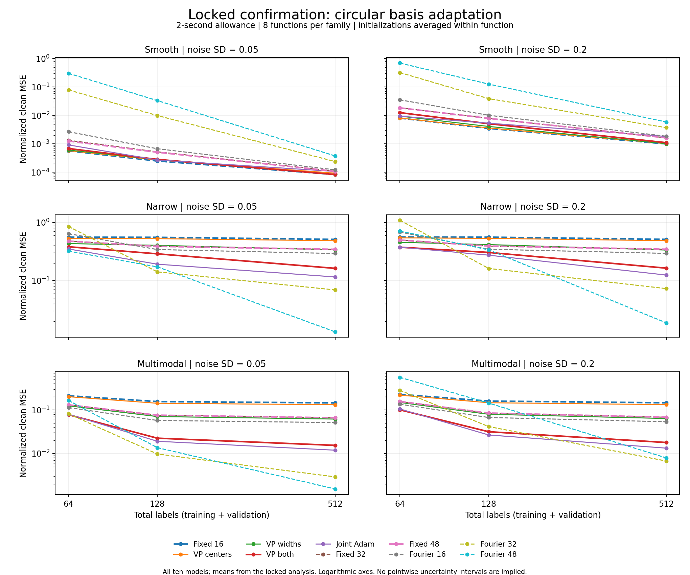

# Circular locality v2: final audited results

Completed 2026-09-21. **The locked overall continuation gate failed.** Learning
both centers and widths with variable projection reduced aggregate error
54.54% against the equal-basis fixed16 control and 35.85% against the locked
equal-parameter fixed48 control. However, smooth-family error increased 47.58%
against fixed16, exceeding the unchanged 10% limit. The result supports a
conditional benefit on these narrow and multimodal synthetic targets, not a
general advantage. Variable projection's aggregate error was **15.05% higher
than joint Adam's**. No alternative arm replaces the locked primary model.

All **5,504 records completed without failed or retried fits**. The full suite
passed **1,262 tests**. Confirmation checkpoint replay passed, and a separately
implemented final aggregation audit passed **95,830 checks**. Numerical and
protocol correctness do not change the failed scientific decision.

Durable artifacts: [complete run record](vm_locality_v2_run_record.json),
[all 720 confirmation cells](vm_locality_v2_cells.csv), and
[confirmation figure](figures/vm_locality_v2_confirmation.png)
([vector version](figures/vm_locality_v2_confirmation.svg)). The JSON retains
configuration, source/evidence hashes, environment, all model/target/family
statistics, intervals, gates, timings and numerical diagnostics. Exact arrays
and states remain in the ignored local results directory; a fresh clone does
not contain those raw artifacts.

## Question and scope

When does adapting circular basis locations and widths improve prediction under
equal label and computation budgets? The saved
[literature review](vm_literature_review.md) motivates this follow-up. The
[prospective protocol](vm_locality_v2_protocol.md) and
[configuration](../configs/vm_locality_v2.json) specify its comparisons and gates.
This study does not change the completed, negative v1 confirmation findings.

The implementation uses differentiable positive-ridge variable projection to
separate learning centers, learning widths, and learning both. Joint Adam starts
from the same exact readout. Fixed circular and Fourier controls include both
equal-basis and equal-fitted-parameter comparisons. These controls address
different questions; parameter count does not completely match functional
capacity or regularization.

## Implementation and preflight, 2026-09-21

New successor modules are `src/locality_models.py`, `src/locality_tasks.py`,
`src/locality_training.py` and `src/locality_protocol.py`. The runner and
independent artifact observer are `scripts/run_vm_locality.py` and
`scripts/analyze_vm_locality.py`. No forecaster adapter was introduced.

The verified environment is Python 3.11.4, PyTorch 2.5.1+cu121 and an NVIDIA
RTX 3060 Laptop GPU. GPU fits are serialized; no global installation changed.
CPU/BLAS threads are limited during experiments. Focused numerical, task, trainer
and runner tests passed **142 tests**; protocol guards passed **59 tests** and the
artifact observer **43 tests**, for **244 focused tests**. The complete repository
suite passed **1,262 tests in 86.37 seconds**. All ten actual trainer-to-observer
CPU integrations passed after saving and reloading their artifacts. Independent
numerical/tasks and protocol/runner/analysis reviews passed against the frozen
scientific source hashes. These were cross-reviews by agents with different
implementation ownership, not external human or blinded peer review.

The initial independent CPU implementation probe passed 208 checks on disposable
fixtures, including generator equations and nested pools, finite-difference
gradients, augmented least-squares readouts and runner interruption handling.
Independent readout coefficients differed by at most approximately 4e-15.
Tiny CUDA checks found CPU/GPU feature differences below 3e-16 and readout
differences below 4e-14. These are numerical evidence, not methodological gains.

Review found and corrected two orchestration problems before formal fitting:
the runner could continue after an interrupted fit, and repeatedly writing the
growing manifest incurred a cost absent from small pilot timing estimates.
Immutable per-fit journals now preserve failed/interrupted evidence; the full
matrix is saved at start and finish. A synthetic maximum-size storage benchmark
projected approximately **13.5 seconds** of journal/status/full-matrix writes,
compared with **847 seconds** for the previous repeated full-matrix shape.
These are storage projections, not observed end-to-end training speedups.

The final independent review passed **597 unique checks**, with no unresolved
findings (179 numerical/task checks and 419 protocol/runner/analysis checks,
sharing one provenance check). Earlier failed review attempts and their
corrections remain preserved locally.

A terminal receipt checks the phase deadline after the final full manifest is
flushed and hashed. Confirmation access requires source/config/evidence-bound
pilot choices, development choices, feasibility, full-suite proof and independent
review. Complete lock-verification overhead was measured before reserved
function generation and charged against the unchanged confirmation ceiling.

The preservation inventory covers 110 preexisting files. At the last preflight
check, only the authorized `docs/project_state.md` handoff update differed.
Frozen v1 sources/configuration and the owner's `VM_exploration.md` were intact.

Local detailed evidence is under
`results/vm_locality_v2/implementation_20260921/`; that directory is ignored by
Git, so this document and its companion JSON/CSV retain the compact findings.
The implementation and unit tests establish no scientific benefit themselves.

## Formal pilot

The source-frozen 224-record serialized CUDA pilot ran at
`results/vm_locality_v2/study_20260921/pilot` after the passing full suite,
independent reviews and ten-model integration check. **All 224 records completed
in 273.67 seconds**, within the unchanged 600-second ceiling, with no failed or
retried records. Independent replay passed **all 4,197 checkpoints**. Maximum
prediction discrepancy was 2.22e-15 and independent ridge-weight discrepancy
2.66e-13; matched initial geometry/readout differences were exactly zero.
Every pilot fit had an eligible checkpoint at all three time allowances.

Median adaptive trajectories completed 260 updates for `vp_both`, 270 for
`vp_centers`/`vp_widths` and 450 for `joint_both`. Median fixed-control fit times
ranged from 0.01158 to 0.04103 seconds. Adaptive trajectory medians ranged from
2.02325 to 2.05296 seconds including the recorded terminal block overshoot;
checkpoints finishing after 2 seconds remained ineligible. These update counts
describe solver cost on this device, not relative optimization quality.

The prespecified mean noisy-validation rule selected **0.1** for all four
adaptive models. It did not use clean-grid scores or timing-panel scores.

| Model | Selected rate | Mean selection-panel validation MSE |
| --- | ---: | ---: |
| vp_centers | 0.1 | 0.16656422 |
| vp_widths | 0.1 | 0.12455807 |
| vp_both | 0.1 | 0.06926038 |
| joint_both | 0.1 | 0.04231991 |

The maximum-shape fixed-call p90 was 0.047375 seconds, per-cell non-fit overhead
p90 0.052822 seconds, and maximum adaptive atomic-block overshoot 0.086732
seconds. The prescribed full-matrix projections are **1,378.95 seconds** for
development versus a 2,700-second ceiling, and **3,577.21 seconds** for
confirmation versus 5,400 seconds. Both passed. At that point confirmation still
required a verified lock and an additional measured allowance for its repeated
full verification; the base projection alone did not authorize reserved access.

Pilot errors are tuning diagnostics on four functions, not methodological
evidence or a comparison selected for publication. The 1,440-record development
phase completed in the sibling `development` directory in **1,247.57 seconds**,
within its unchanged 2,700-second ceiling; every record completed without a
retry. Its full artifact audit passed all **19,313 checkpoints**, with zero
failed checks. Maximum prediction discrepancy was 3.55e-15; the maximum
independent ridge-weight discrepancy was 7.15e-13. Reserved confirmation
functions had not been generated or scored when this development audit finished.

Before confirmation, presentation was specified as primary-time cell means for
all ten models against total labels, separately for each periodic family and
noise level. The completed plot uses saved analysis values directly, without a
new scoring rule, subset selection or confidence interval. All four families and
all time allowances remain in the tabulated analysis.

## Development selection

The prespecified selection chose **vp_both** and **fixed48**, each with 49 fitted
scalar parameters. Selection uses the complete periodic-family balanced primary
error, averaging initializations, noise and label budgets within target first.
These are selection outcomes, not confirmation findings.

| Model | Development balanced normalized clean MSE |
| --- | ---: |
| fixed16 | 0.25751451 |
| vp_centers | 0.24404668 |
| vp_widths | 0.16064807 |
| vp_both | 0.10984882 |
| joint_both | 0.10075629 |
| fixed32 | 0.16841249 |
| fixed48 | 0.16843736 |
| fourier16 | 0.21196485 |
| fourier32 | 0.37108345 |
| fourier48 | 0.27411822 |

Against fixed16, vp_both reduced aggregate error **57.34%** (paired whole-target
bootstrap 95% interval: **39.44% to 76.22%**). Narrow and multimodal families
improved 47.23% and 84.24%, respectively, but smooth error **increased 12.23%**.
That breaches the unchanged 10% maximum-family-regression gate, so this contrast
and the overall development gate **fail**.

Against fixed48, aggregate improvement was **34.78%** (95% interval **22.39% to
45.99%**); all three periodic families improved and that descriptive gate passes.
The isolated optimizer comparison favored joint Adam: vp_both error was **9.02%
higher** (improvement interval **-27.92% to -3.44%**). Thus these development data
do not establish a variable-projection advantage over the joint optimizer.

The negative gate and optimizer findings remain in the record. Confirmation
kept both selected co-primary comparisons, all ten model arms, every budget
and noise level, and the existing thresholds.

## Confirmation lock and launch

Lock SHA256:
`5dfcf1b76b34c9b0eabb5cdce75e3541f3ae237281c4d4c57c17c4d3dda1b498`.
It binds the complete pilot/development evidence, rates, selected comparisons,
canonical sources/configuration, passing full suite and independent review.

Before reserved access, a complete read-only verification took **18.30984
seconds**. Charging that cost for all 32 reserved target bundles adds **585.91
seconds** to the base projection, yielding **4,163.12 seconds** against the
unchanged **5,400-second** ceiling. The additional feasibility check passed and
was saved as `confirmation_guard_feasibility.json`. It generated no reserved
functions. The locked 3,840-record serialized CUDA phase completed in the sibling
`confirmation` directory in **3,921.49 seconds (65 minutes 21 seconds)**, within
the unchanged ceiling. All records completed; no failed fits, retries or survivor
selection occurred. The confirmation artifact audit passed all **52,301 saved
checkpoints**, with zero failed checks. Maximum prediction replay discrepancy
was **4.44e-15**, independent ridge-weight discrepancy **6.95e-13**, and matched
initial-readout discrepancy exactly zero. All fits had eligible checkpoints at
all three allowances.

An independent implementation then replayed the complete 3,840-record matrix,
summary/journal bindings, all 720 detail-cell means, target/family aggregation,
paired bootstrap intervals and locked decisions. It passed **95,830 checks**
with no findings and maximum absolute discrepancy **2.11e-13**. Its report SHA256
is `5c593e53e5afe2ab47165fe911ad104c958c8a15e6eb883d7c7435fa07c9e553`.
This is an independent agent implementation of the aggregation, not independent
experimental replication or external peer review.

## Locked confirmation decisions

Primary error is clean-grid MSE divided by target variance, at the **2-second**
allowance. Each of eight functions per family first averages both
initializations, both noise levels and all three total-label budgets. Functions
are averaged within family, then the three periodic families receive equal
weight. Thus 3,840 fit records do not constitute 3,840 independent tasks.
Intervals use 10,000 paired whole-function bootstrap resamples within families.
Both co-primary gates must pass; neither a positive aggregate interval nor the
passing fixed48 contrast overrides a family regression.

| Locked contrast: vp_both against | Aggregate error reduction | Paired 95% interval | Smooth | Narrow | Multimodal | Gate |
| --- | ---: | ---: | ---: | ---: | ---: | --- |
| fixed16, equal basis count | 54.54% | 43.80% to 68.13% | -47.58% | 48.50% | 74.60% | **Fail: smooth regression** |
| fixed48, equal fitted scalar count | 35.85% | 18.67% to 55.04% | 33.53% | 31.47% | 54.34% | Pass |

Positive percentages mean lower error for vp_both; negative percentages mean
higher error. Smooth error was 0.00330364 for vp_both versus 0.00223850 for
fixed16: the absolute increase is approximately 0.00106514 despite the large
relative increase. This scale difference helps explain the simultaneous large
aggregate gain and failed family gate; it does not justify changing the gate.

The prespecified optimizer contrast also disfavors variable projection:
vp_both error **0.10880447** versus joint_both **0.09457338**, or **15.05% higher**.
The improvement interval is **-25.35% to -8.84%**. All three family means favor
joint Adam. Both start from the same exact ridge readout, but joint Adam does
more updates in the time allowance; this evaluates the complete timed methods,
not convergence after equal update counts or exact optimization.

## All model outcomes and conditional answer

All values below are normalized clean MSE at 2 seconds. The nonperiodic column
is diagnostic and excluded from the balanced primary score. All ten models
are periodic; there is no unrestricted nonperiodic comparator in v2.

| Model | Balanced periodic | Smooth | Narrow | Multimodal | Nonperiodic |
| --- | ---: | ---: | ---: | ---: | ---: |
| fixed16 | 0.23933620 | 0.00223850 | 0.54143889 | 0.17433122 | 0.13710943 |
| vp_centers | 0.22685463 | 0.00228659 | 0.51610982 | 0.16216748 | 0.13210957 |
| vp_widths | 0.16338866 | 0.00258663 | 0.39615544 | 0.09142392 | 0.11143858 |
| vp_both | 0.10880447 | 0.00330364 | 0.27882253 | 0.04428725 | 0.08964051 |
| joint_both | 0.09457338 | 0.00297924 | 0.23802044 | 0.04272047 | 0.08549636 |
| fixed32 | 0.16955736 | 0.00502605 | 0.40669377 | 0.09695225 | 0.11536466 |
| fixed48 | 0.16961443 | 0.00497004 | 0.40688040 | 0.09699286 | 0.11553444 |
| fourier16 | 0.17348472 | 0.00847227 | 0.43230650 | 0.07967538 | 0.11181880 |
| fourier32 | 0.18150040 | 0.07592759 | 0.39756995 | 0.07100366 | 0.14171653 |
| fourier48 | 0.20177538 | 0.19468125 | 0.26196374 | 0.14868114 | 0.24049360 |

The prespecified cells show the following conditional pattern. These are
descriptive readings of the full matrix, without additional subgroup tests or
replacement selection rules.

- On narrow and multimodal targets, vp_both has lower mean error than both
  fixed16 and fixed48 in **every label/noise cell**. Centers alone change little;
  width adaptation improves more, and adapting both improves further under this
  configuration. The different fitted parameter counts remain relevant.
- Smooth targets already fit well with fixed16. Adaptation generally adds
  error, especially at noise SD 0.2. At 64 labels there, fixed16 gives 0.00804464
  versus vp_both 0.01255857. At 512 labels/noise 0.05 they are effectively tied
  at about 0.0000831. The family regression is retained, not averaged away.
- Larger Fourier bases are strong when labels are plentiful. At **512 labels**,
  fourier48 narrow errors are **0.01314791 / 0.01871465** at noise 0.05 / 0.2,
  versus vp_both **0.16214926 / 0.16344763**. On multimodal targets at the same
  budget, fourier32 and fourier48 both beat vp_both at both noise levels. Their
  poor small-sample cells contribute to their worse overall means. Therefore
  beating the locked fixed48 bank is not superiority to every equal-parameter
  basis in every regime.
- At **0.25 seconds**, vp_both's balanced error is 0.184791, worse than fixed48's
  0.169614. At 0.75 seconds it is 0.146356, and at 2 seconds 0.108804. Benefit
  depends on available computation as well as target structure and labels.

## Runtime and numerical diagnostics

Total-label budgets 64, 128 and 512 include validation: training sizes are 48,
96 and 384, with 16, 32 and 128 validation labels. All models receive the same
available fit time. Fixed controls finish one ridge solve and consume much less
time; their unchanged scores across allowances do not imply equal actual cost.

| Model | Error at 0.25 s | Error at 0.75 s | Error at 2 s | Median total fit seconds | Median completed updates |
| --- | ---: | ---: | ---: | ---: | ---: |
| fixed16 | 0.239336 | 0.239336 | 0.239336 | 0.01210 | 0 |
| vp_centers | 0.227266 | 0.226857 | 0.226855 | 2.03603 | 270 |
| vp_widths | 0.197201 | 0.172813 | 0.163389 | 2.03728 | 280 |
| vp_both | 0.184791 | 0.146356 | 0.108804 | 2.03560 | 260 |
| joint_both | 0.191618 | 0.140633 | 0.094573 | 2.02392 | 460 |
| fixed32 | 0.169557 | 0.169557 | 0.169557 | 0.01789 | 0 |
| fixed48 | 0.169614 | 0.169614 | 0.169614 | 0.03991 | 0 |
| fourier16 | 0.173485 | 0.173485 | 0.173485 | 0.01051 | 0 |
| fourier32 | 0.181500 | 0.181500 | 0.181500 | 0.01370 | 0 |
| fourier48 | 0.201775 | 0.201775 | 0.201775 | 0.02702 | 0 |

Fit totals and update counts include the terminal atomic-block overshoot; only
fully captured checkpoints within each allowance can be selected. The maximum
confirmation overshoot was **0.14178 seconds**; it exceeded the pilot maximum
0.08673 seconds, illustrating that the feasibility projection was an estimate.
The full phase nevertheless finished within its unchanged ceiling. No fit hit
the 6,000-update cap and no allowance was missing.

Across all saved confirmation checkpoints, including late terminal states,
vp_both concentrations ranged **0.42479 to 37.20355**, vp_widths **0.27164 to
45.57640**, and joint_both **0.32841 to 59.27497**. Centers-only concentration
stayed exactly 4. Frozen geometry was checked; exact centers and widths for
every checkpoint are retained in the local artifacts. These ranges describe
the realized geometry and do not establish recovered physical widths.

The largest regularized normal-matrix condition number was **2,486.82**
(fourier48); vp_both's maximum was **1,280.73**. The largest readout L2 norm was
**9.52430**. For ridge/VP states, maximum readout stationarity residual was
**1.43e-15**, and independently re-solving the ridge readout changed predictions
by at most **5.20e-14**. Joint Adam's later readouts are intentionally not ridge
optima; its stationarity residual reached 0.14784. Its ridge re-solve check
applies only at initialization, and no post-training refit was performed.
These are numerical solver/replay diagnostics, not a perturbation robustness
study or evidence that coefficients are identifiable.

| Phase | Completed records | Elapsed seconds | Unchanged ceiling | Audited checkpoints |
| --- | ---: | ---: | ---: | ---: |
| Pilot | 224 | 273.67 | 600 | 4,197 |
| Development | 1,440 | 1,247.57 | 2,700 | 19,313 |
| Confirmation | 3,840 | 3,921.49 | 5,400 | 52,301 |

Totals are **5,504 records** (2,240 adaptive and 3,264 fixed) and **75,811 audited
checkpoints**. Phase runtime includes orchestration/final manifest completion;
preflight, analysis and report generation are additional. No favorable-survivor
selection, fit retry, source edit, learning-rate change, comparator change or
gate relaxation occurred during confirmation.

## Interpretation, limitations and preservation

The conditional answer is: adapting circular geometry helped relative to the
specified fixed circular dictionaries on narrow and multimodal functions when
given enough of this measured compute allowance. It did not improve an already
suitable smooth fixed basis, did not beat larger Fourier bases in the
well-sampled regimes, and variable projection did not beat joint Adam overall.
The two co-primary requirements therefore do not establish a successful general
continuation result. Stage C and forecasting were not launched.

This study uses eight confirmation functions per family, fresh within generator
families already known from v1. The contract was frozen locally before reserved
access, not externally preregistered. Function-level bootstrapping reflects this
small synthetic sample and is not a powered population or unseen-domain claim.
Fixed dictionaries, initialization, positive ridge penalty 0.001, validation
sizes and the learning-rate grid all bound the conclusion. Equal scalar counts
and the same coefficient penalty do not equalize functional capacity or
function-space regularization. The float64, instrumented two-second CUDA result
is hardware-dependent; a wall-clock rerun need not select identical checkpoints.
No new forecasting adapter was introduced, so these results are not standard
synthetic forecaster acceptance or deployment validation.

The literature already contains VM basis networks and variable projection.
Peak-normalized VM kernels remain exactly Gaussian RBFs on the circle embedding;
the comparison gives no evidence of a distinct new kernel or general novelty.
The different v2 result does not reverse the frozen v1 result: the label
accounting, regularization, initialization, optimization and time budgets differ.
Any further scientific change would require a new question and fresh reserved
functions, not reuse of these confirmation outcomes as tuning data.

The post-run inventory verified all **110 preexisting files**, with only the
authorized `docs/project_state.md` handoff changed. Scientific sources match
their pre-full-suite hashes. The original v1 lock still verifies all **13 source
files and 876 development dependencies**, with unchanged SHA256
`077e786046909cd5966732a66bd56c53a715e5bb738173a17782a387e9ed9afd`.
The owner's `VM_exploration.md` remains unchanged (SHA256
`d76ae1df27b4ecbc48a33aadc81dcf08d199e69025a4a6419972c3a58f179fe0`).
No historical result was overwritten, and no global Python installation was
modified.
