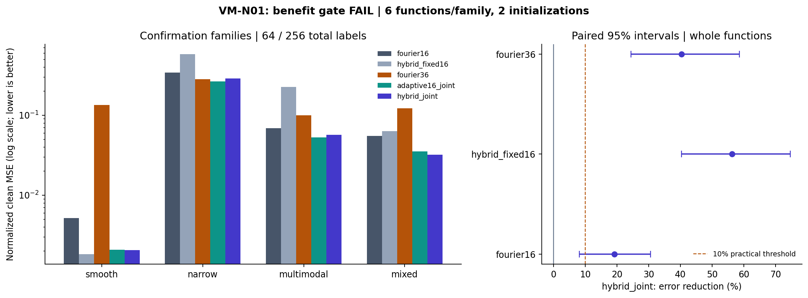

# VM-N01 results: smooth backbone with localized circular corrections

## Material Passport

- Date: 2026-09-22. Scope: the explicitly approved VM-N01 task only.
- Origin: academic-research-suite / experiment-agent; prospective plan,
  implementation, execution and statistical interpretation.
- Status: **completed; the locked scientific benefit gate failed**.
- Verification: numerical/engineering tests passed; independent saved-state
  equation, selection and aggregation replay passed. This is not a second
  timed training reproduction, external preregistration or real-world validation.
- Contract: [protocol](vm_n01_protocol.md), [configuration](../configs/vm_n01_v1.json),
  [initial freeze receipt](vm_n01_protocol_freeze.json).

## Answer to the research question

The selected **Fourier-plus-adaptive-kernel model fitted with joint Adam**
improved balanced clean error against the three locked controls. However, its
smooth-family error was **11.97% higher than the fixed hybrid**, exceeding the
unchanged **10%** guard. The intended combination of useful local improvement
and acceptable smooth preservation was therefore **not established** under this
protocol. A failed benefit gate completes the scientific task.

The larger Fourier basis remained substantially stronger at 256 total labels.
Kernel-only joint Adam also had lower overall error than the selected hybrid,
although it had 49 fitted parameters versus 37. These observations do not support
a general advantage for adding this low-order backbone. V1/v2 findings and their
failed gates remain unchanged; different functions and budgets prevent treating
this study as a numerical correction to their results.

## Locked confirmation comparisons

Metric: clean-grid MSE divided by clean-grid variance, dimensionless and lower
is better. Average labels and initializations within each function, then give
the four periodic families equal weight. Selected hybrid error: **0.09478145**.
Intervals resample whole paired functions within family 10,000 times; six
functions per family, 24 periodic functions in total. They are descriptive
percentile 95% intervals, not a powered population guarantee.

| Control | Contrast | Control error | Hybrid error reduction, paired 95% interval | Smooth error change | Gate |
| --- | --- | ---: | ---: | ---: | --- |
| Fourier16 | Equal 16 basis columns | 0.11732274 | 19.21% [8.12%, 30.59%] | -60.20% | Pass |
| Hybrid fixed16 | Equal 16 basis columns | 0.21708838 | 56.34% [40.38%, 74.64%] | **+11.97%** | **Fail** |
| Fourier36 | Equal 37 fitted parameters | 0.15903948 | 40.40% [24.43%, 58.58%] | -98.48% | Pass |

All comparisons passed their aggregate 10% practical-effect threshold, positive
lower interval, and improvement in at least two of narrow/multimodal/mixed.
The fixed-hybrid smooth guard alone failed; the success rule requires every
check for every comparison. A positive aggregate or another passing control
cannot override it. The interval rule requires its lower endpoint above zero,
not above the 10% practical-effect threshold; the latter applies to the estimate.

The smooth errors were 0.00204512 versus 0.00182657: an absolute normalized-MSE
increase of 0.00021855. The paired increase had sample SD 0.00048823 across six
functions, with four of six worse. The increase is small in absolute units,
but the prospective point-estimate guard is not rounded down or revised.
Relative to the descriptive fixed16 reference, smooth error also rose 10.66%.

The figure shows mean family errors on a log scale and aggregate paired
intervals. Its failed gate is explained by the smooth guard above; positive
aggregate intervals do not imply that all guards pass.

## Every model at the primary one-second allowance

Values below average both label budgets and both initializations. The
nonperiodic column is diagnostic and excluded from the balanced periodic mean.
Full function SDs and paired observations are retained in the machine-readable
record and [function table](vm_n01_function_results.csv).

| Model | Basis / fitted params | Smooth | Narrow | Multimodal | Mixed | Nonperiodic | Balanced periodic |
| --- | ---: | ---: | ---: | ---: | ---: | ---: | ---: |
| Fourier16 | 16 / 17 | .005139 | .340586 | .068685 | .054881 | .124664 | .117323 |
| Fixed16 | 16 / 17 | .001848 | .515079 | .191998 | .055273 | .144294 | .191049 |
| Adaptive16 joint | 16 / 49 | .002062 | .263419 | .052538 | .035303 | .104557 | **.088331** |
| Adaptive16 VP | 16 / 49 | .001855 | .293554 | .071214 | .037363 | .114322 | .100996 |
| Hybrid fixed16 | 16 / 17 | .001827 | .578553 | .224991 | .062983 | .165094 | .217088 |
| Hybrid joint | 16 / 37 | .002045 | .288298 | .056720 | .032063 | .108208 | .094781 |
| Hybrid VP | 16 / 37 | .001865 | .329154 | .070442 | .037494 | .114157 | .109739 |
| Fourier36 | 36 / 37 | .134203 | .280230 | .099575 | .122150 | .318655 | .159039 |
| Fixed36 | 36 / 37 | .003028 | .458821 | .172144 | .051139 | .141913 | .171283 |
| Hybrid fixed36 | 36 / 37 | .002726 | .367353 | .125929 | .043488 | .136956 | .134874 |
| Line RBF16 | 16 / 17 | .002456 | .420894 | .151192 | .055006 | **.001513** | .157387 |

Joint Adam had 13.63% lower balanced hybrid error than VP (paired interval
7.66% to 25.61%). For kernel-only models its error was 12.54% lower (3.33% to 27.53%).
These are descriptive optimizer contrasts under wall-clock allowances, not
matched-update evidence that Adam is universally preferable. Hybrid joint had
7.30% higher aggregate error than kernel-only joint; the latter has 12 additional
fitted parameters and six additional adaptive kernels.

The unrestricted line basis attained nonperiodic error 0.00151260 versus the
selected periodic hybrid's 0.10820849. This diagnoses the periodic model class
on an explicitly nonperiodic target; it is not a reason to include that family
in the periodic benefit gate or to tune away the diagnostic.

## Label and computation dependence

Total labels include training and validation: 64 = 48 + 16; 256 = 192 + 64. Table entries
are balanced periodic normalized MSE. The final column averages both label
budgets at the secondary 0.25-second allowance.

| Model | 64 labels, 1 second | 256 labels, 1 second | Both labels, 0.25 second |
| --- | ---: | ---: | ---: |
| Fourier16 | .161930 | .072715 | .117323 |
| Fixed16 | .209362 | .172737 | .191049 |
| Adaptive16 joint | .115703 | .060958 | .147219 |
| Adaptive16 VP | .126913 | .075080 | .154995 |
| Hybrid fixed16 | .232605 | .201571 | .217088 |
| Hybrid joint | .127705 | .061858 | .153832 |
| Hybrid VP | .140763 | .078715 | .160950 |
| Fourier36 | .302356 | **.015723** | .159039 |
| Fixed36 | .211348 | .131218 | .171283 |
| Hybrid fixed36 | .161079 | .108669 | .134874 |
| Line RBF16 | .185212 | .129561 | .157387 |

The aggregate hybrid advantage against Fourier36 coexists with a reversal at
256 labels: Fourier36 error 0.015723 versus hybrid 0.061858. Its poor 64-label
result is visible rather than pooled away. At 0.25 seconds the selected hybrid
also has higher balanced error than Fourier16. Neither more computation nor
more labels can be assumed interchangeable across these representations.

Raw features receive the same 0.001 readout penalty and an unpenalized intercept.
Their scale/correlation and fitted capacities differ; equal coefficient penalties
are not equal function-space regularization. Fixed fits stop after one solve.
Confirmation mean fitting times were 6.28–10.01 ms for the seven fixed arms,
1.019–1.041 seconds for adaptive arms including the final late block. Selected
checkpoints themselves completed within their allowance. The maximum observed
fit duration was 1.09493 seconds; late states remain archived and ineligible.
Mean selected update counts were 172.5 joint versus 95.5 VP for the hybrid.
See [every model's measured runtimes](vm_n01_runtime.csv); equal available
computation does not mean equal actual cost or equal update count.

## Execution, selection and preserved evidence

The protocol was frozen before implementation/target experiments. Scientific
sources were frozen after required checks and before pilot. No source, label
budget, rate candidate, selection rule, comparator or criterion changed during
the three formal phases. All 1,615 fits completed without failed or retried fits;
all 3,230 declared allowance rows are retained locally. The smaller prospective
design stayed below the completed locality-v2 planning ceilings.

| Phase | Functions / initializations | Fits | Receipt runtime | Frozen ceiling | Independent checkpoints |
| --- | --- | ---: | ---: | ---: | ---: |
| Pilot | 1 per family / 1 | 75 | 44.52 s | 240 s | 870 |
| Development | 2 per family / 1 | 220 | 88.71 s | 600 s | 1,786 |
| Confirmation | 6 per family / 2 | 1,320 | 568.22 s | 1,800 s | 10,685 |

Pilot selected rate 0.05 for all four adaptive models by the frozen noisy-
validation rule. Development selected hybrid joint (error 0.10292633) rather than
hybrid VP (0.12327376), and Fourier36 (0.12810364) rather than fixed36 (0.15898946)
or hybrid fixed36 (0.13321646). Development passed its descriptive gate; that did
not determine confirmation's gate. Measured development projection was 189.88 s.
Full lock verification took 1.5593 s; charging 31 entry/target guards yielded
887.61 s confirmation projection, below the unchanged 1,800 s ceiling. A timing-only
proof could not authorize target generation. Phase runtimes include guard and
artifact work; process startup and the tiny final terminal-receipt write are
outside those receipt timings.

All models share exact observations. Unique observational labels, including
tuning/validation, total 1,280 pilot + 2,560 development + 7,680 confirmation
= **11,520**. Initializations/rates reuse labels. Deterministic clean grids define
generator normalization/integration, not extra observed training labels.
Phase roots are 31092201 / 31092202 / 31092203, initialization 31092204, analysis 31092205;
the protocol records stream separation. Every generated array/function has a
saved identity. Reserved functions are now consumed; another run is reproduction,
not fresh confirmation.

Independent NumPy equation replay checked **13,341 checkpoints** across all
phases and recomputed validation selection, clean metrics, function aggregation,
paired intervals and gates. All **491,581 checks** passed. Maximum numerical
difference was 8.33e-12. No target was regenerated or fit rerun for the audit.
The separate observer's source hash and receipts are in
[the audit summary](vm_n01_audit_summary.json). See
[implementation review](vm_n01_implementation_review.json) and
[numerical review](vm_n01_numerical_review.json) for pre-freeze checks and fixes.

## Engineering validation and implementation

**1,429 tests passed in 82.73 s** (87.10 s including process overhead). Coverage
includes exact equations, wrap consistency, finite gradients, independent ridge
least squares, VP gradients, shape/dtype/device behavior, CPU/CUDA agreement,
state replay, timing eligibility, complete evidence and interruption failures.
All inherited scientific sources/configs/notes stayed byte-identical; only the
authorized project-state handoff was extended.

The narrow adapter uses per-sensor M3/K10 features, Linear32, LayerNorm/dropout 0.1,
LSTM64 and head12. It ran the unchanged standard synthetic generator, split,
preprocessing, 50-epoch trainer, metrics and absolute gates via imported APIs.
This is an integration check of that concrete adapter, not validation of static
basis superiority or a new forecasting study.

| Standard seed 42 model | Parameters | RMSE ppm | MAE ppm | R2 | MAPE % | Absolute gate |
| --- | ---: | ---: | ---: | ---: | ---: | --- |
| Fresh base VM | 43,148 | 5.35727 | 4.15081 | .97896 | .69163 | Pass |
| SmoothLocalForecasterV1 | 28,032 | 5.15322 | 4.08604 | .98053 | .67904 | Pass |

Both saved CUDA predictions replayed bit-for-bit and metrics recomputed exactly.
CPU/GPU outputs differ slightly: maximum normalized difference 7.15e-7 for the
adapter and 1.98e-4 for the inherited base. The initial overly strict base CPU
assertion and corrected backend-specific interpretation remain recorded in the
review; no training was repeated. Thresholds remain RMSE<=35, MAE<=25, R2>=.20,
MAPE<=5%. Static arms are numerically checked; they do not inherit this forecaster
gate. Standardized sensor values treated as angles do not establish physical
circularity of those sensors.

## Identity, deliverables and limits

Environment: Windows 10, Python 3.11.4, PyTorch 2.5.1+cu121, NumPy 1.26.4,
CUDA 12.1, RTX 3060 Laptop GPU; one serialized fitting process, one CPU/BLAS thread,
float64 static fitting and float32 adapter. No dependency/global installation
changes. Git HEAD was `a7431a926c751868b11a3918c6cdd29be6540a32` with task changes;
HEAD alone is not the code identity. The run record binds all 84 scientific files.

Confirmation lock SHA256:
`93a3aebeb3563ca3fdd2208182bb7913a72ae6b7342213b7477b8149ca38fa5f`.
Inherited snapshot SHA256:
`18191869b3383ee437e33de713b4aaed6a7f103e9ae88c5581ce8ea8a44f31b5`.
All 130 inherited entries were verified before the contained overlay; see the
[baseline receipt](vm_n01_inherited_baseline.json). The original checkout and
supplied research context were not edited.

New versioned implementation, runner and usage are indexed in
[vm_n01_usage.md](vm_n01_usage.md). Compact durable evidence:
[run record](vm_n01_run_record.json), [all 440 development/confirmation cells](vm_n01_cells.csv),
[all 880 function results](vm_n01_function_results.csv),
[all 150 pilot allowance results](vm_n01_pilot_results.csv),
[runtime table](vm_n01_runtime.csv), and [completion record](vm_n01_completion.json).
Exact arrays, checkpoints, locks and full audit receipts stay in the ignored
`results/vm_n01_v1/` archive of this worktree; a fresh clone lacks them.

These are six new functions per family from familiar generators at one noise
level, two label budgets and a hardware-dependent small compute allowance.
Candidate/regularization choices and the M3/K10 decomposition are specific;
the components need not be identifiable. Percentile intervals and favorable
subgroups do not override the failed guard. No novelty, universal superiority,
real-world utility, LSTM replacement or physical broad/local decomposition is
established. The [11-point interpretation review](vm_n01_interpretation_scope.md)
states the statistical boundaries. No VM-N02, forecasting, uncertainty or control
follow-up was launched, and no automatic new search is proposed by this result.
