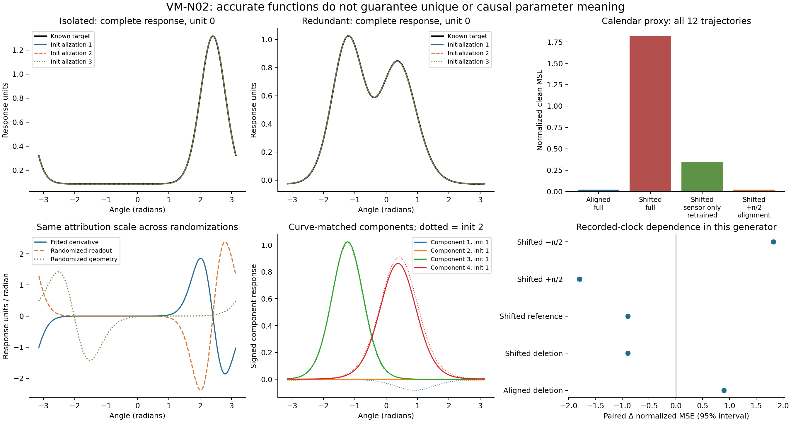

# VM-N02: what phase and width parameters can explain

## Material Passport

- Origin: academic-research-suite / experiment-agent, authorized bounded study.
- Question: parameter recovery, response stability and intervention dependence
  in three known mechanisms, using existing circular model APIs.
- Evidence class: exact identities plus fresh within-generator synthetic tests.
- Protocol: [frozen contract](vm_n02_interpretation_protocol.md) and
  [configuration](../configs/vm_n02_interpretation_v1.json).
- Provenance: [baseline](vm_n02_baseline_receipt.json),
  [reference context](vm_n02_context_receipt.json), and
  [execution notes](vm_n02_execution_notes.md).
- Status: complete, 2026-09-22; prospectively specified science with a disclosed
  operational amendment after pilot execution. No fit was repeated.

## Findings

**Phases and widths recovered in the deliberately identifiable single-peak
case. They were not stable component descriptions in the redundant case.
Calendar reliance predicted error under an association shift but did not identify
a direct role in the target equation.** These are distinct conclusions; there
is no combined scientific success gate.

Reserved evaluation retained all **36 independent units / 84 full fits**, plus
12 separately retrained sensor-only readouts. The two peak cases each comprise
12 functions with three initializations; the proxy comprises 12 independent
trajectory units with a unique ridge optimum. No numerical fit failed or was
retried. Across pilot, development and evaluation, all 102 peak fits, 17 full
proxy fits and 17 additional sensor-only solves are retained.

| Reserved outcome | Mean [paired-unit 95% interval] | Declared verdict |
|---|---:|---|
| Isolated clean NRMSE | 0.00429 [0.00337, 0.00531] | Pass <= 0.1 |
| Isolated between-initialization curve NRMSE | 0.00264 [0.00155, 0.00376] | Pass <= 0.05 |
| Isolated parameter recovery | 36/36 fits; 12/12 function means equal 1 | Pass >= 0.9 |
| Redundant clean NRMSE | 0.05073 [0.03467, 0.06597] | Mean passes <= 0.1; only 26/36 individual fits do |
| Redundant between-initialization curve NRMSE | 0.07209 [0.04876, 0.09372] | **Fails** <= 0.05 |
| Aligned proxy clean NRMSE | 0.14585 [0.14309, 0.14838] | **Fails** <= 0.1 |
| Shifted proxy clean NRMSE | 1.34867 [1.33760, 1.35995] | Strong deterioration under changed association |

NRMSE divides RMSE by the clean evaluation target SD; NMSE divides MSE by its
variance, separately within each proxy regime. The mean of NRMSE is not the
square root of mean NMSE. All target units are arbitrary response units, and
angles are radians. The full models contain 4, 13 and 5 fitted parameters for
isolated, redundant and proxy cases; the retrained sensor-only model contains 3.
Every unit supplies 256 noisy training and 128 validation observations, with
512 evaluation observations per regime. Clean 1,024-point peak curves support
mechanism diagnostics and never select fitting checkpoints.

The isolated mean center error was **0.000881 radians** [0.000488, 0.001342],
and mean relative concentration error **0.522%** [0.343%, 0.709%]. Every selected
isolated component was eligible for phase interpretation under the declared
amplitude/variation rules. These results rely on full support, positive amplitude,
the correct single-peak family and a training-derived local initialization.

In the redundant case, signed-curve matching gave weighted center dispersion
**1.117 radians** [0.755, 1.447] and absolute log-concentration dispersion
**0.643** [0.419, 0.853], exceeding the descriptive flags of 0.2 and 0.3.
Mean maximum eligible overlap was 0.655 [0.590, 0.719]. About 3.06 active,
phase-eligible component pairs were matched, with 0.944 unmatched active
components and 1.016 target-SD units of unmatched RMS mass per initialization
pair. Thus the matched subset alone cannot represent all the disagreement.
These flags are descriptive, not tests of physical-source identification.

The redundant model's average accuracy must not be described as universal
response stability: ten fits exceeded NRMSE 0.1, the worst reached 0.18416,
and the stricter mean response-pair gate failed. Mean within-function
initialization SD of NRMSE was 0.04765, versus 0.00102 for isolated peaks.
SD across function-averaged errors was 0.02942 versus 0.00178, respectively.
The latter still contains finite-initialization noise; it is not a purified
variance-component estimate. The exact non-identifiability argument below
holds independently of these optimization outcomes.

## Interventions and interpretation scorecard

Effects below are paired changes in normalized MSE, computed within each fit
or trajectory before whole-unit resampling. A positive effect means worse error.
Each peak intervention targets the component with largest validation-input RMS;
all other component deletions are also saved.

| Intervention | Mean change [95% interval] | Interpretation |
|---|---:|---|
| Isolated full component deletion | +1.31397 [1.27591, 1.35718] | Fitted prediction depends on the peak |
| Isolated phase +pi/2 / -pi/2 | +2.50620 / +2.50600 | Both exceed the 0.1 practical-effect rule |
| Isolated kappa multiplied by 0.5 | +0.14982 [0.14282, 0.15792] | Exceeds 0.1 |
| Isolated kappa multiplied by 2 | +0.0999106 [0.09623, 0.10404] | **Narrowly misses** the fixed 0.1 mean threshold |
| Redundant full component deletion | +5.79513 [3.76878, 7.81092] | Large effect can reflect readout compensation |
| Aligned proxy clock deletion | +0.90038 [0.88880, 0.91201] | Lower bound exceeds 0.1 |
| Shifted proxy clock deletion | -0.89825 [-0.91947, -0.87835] | Removing the fitted proxy now helps |
| Shifted proxy validation-mean replacement | -0.89825 [-0.91947, -0.87835] | Same effect here because complete calendar cycles have zero mean contribution |
| Shifted proxy known +pi/2 alignment | -1.79727 [-1.82777, -1.76741] | Correct oracle alignment helps |
| Shifted proxy opposite -pi/2 offset | +1.82066 [1.79041, 1.84845] | The alignment direction matters |
| Shifted full minus retrained sensor-only error | +1.47671 [1.44722, 1.50686] | Lower bound exceeds 0.1; combined proxy-reliance criterion passes |

The demanding proxy accuracy threshold remains failed. Before any study data,
the declared noise model implied a population-optimal linear NRMSE of about
0.1461. Observed 0.14585 is consistent with that scale; the threshold was not
relaxed. The proxy's strong predictive association and parameter-sensitive
derivative therefore coexist with a failed absolute accuracy criterion and
no direct recorded-clock role in the known generator.

| Interpretation claim | Outcome |
|---|---|
| Isolated phase and concentration can recover known geometry under explicit conditions | Survived this bounded experiment |
| Accurate average predictions imply stable redundant components | Failed; even the response-stability gate failed, and parameters varied more |
| Complete-function derivatives survive exact equivalent representations | Survived; all exact/zero/origin/wrap controls <= 4.89e-15 |
| Derivative display depends on learned parameters | All nine case-by-randomization mean checks exceeded 0.2; smallest mean 0.827 |
| A component's deletion score is invariant to equivalent representations | Refuted: splitting a single contribution changed mean deletion damage from 1.314 to 0.328 while preserving the function |
| A large deletion score establishes a physical component | Refuted by the cancelling-pair construction; deleting an inserted cancelling component gave mean damage 0.299 in the isolated case |
| Calendar reliance establishes a direct physical clock role | Refuted in this known generator |
| Matched redundant centers/widths are recovered physical sources | Unidentifiable |

The [complete scorecard](vm_n02_scorecard.csv) also retains both phase directions,
both width multipliers, every randomization and all failed flags. The
[function/trajectory table](vm_n02_units.csv), [all 84 fit rows](vm_n02_fits.csv)
and [complete compact run record](vm_n02_run_record.json) preserve every declared
metric and interval. No missing/nonfinite evaluation metric was omitted.



Figure: examples always use unit 0, chosen by index rather than outcome. The
nearly overlapping redundant example does not override the full-case stability
failure. Component overlays use the saved signed-curve assignment. Proxy bars
use all 12 trajectories; paired-effect intervals appear in the lower-right panel.
The [SVG version](figures/vm_n02_interpretation.svg) supports export.

## Uncertainty and validation limits

All intervals use 5,000 paired bootstrap draws of the **12 whole independent
functions/trajectories per case**, after averaging three peak initializations or
their unordered pairs within each function. Samples along a curve, component
indices and initialization seeds are not independent scientific replicates.
These are descriptive percentile intervals, not simultaneous familywise tests,
population guarantees or evidence of physical causality. The all-success recovery
bootstrap interval is [1,1] because every observed unit succeeded; it does not
establish a true population recovery probability of one.

The declared mean gates and their uncertainty are reported separately. No p-value
or novelty/superiority claim is made. A methodological scan covered all 11 ARS
patterns: ecological and survivorship errors are guarded by the replication unit
and complete denominators; cases remain separate to avoid Simpson-style pooled
claims; no outcome-based sampling, collider adjustment or extreme-score pre/post
selection is used (Berkson/collider/regression-to-mean checks). Base-rate diagnostic
classification is inapplicable. Look-elsewhere and forking-path risks remain
bounded by frozen metrics, all-outcome reporting and the disclosed operational
amendment; intervals are not multiplicity-corrected. Correlation/causation and
reverse-causality claims are limited by the explicitly known synthetic graph.

The unchanged benchmark passed: VM RMSE **5.35727**, MAE **4.15081**, R2
**0.978959**, MAPE **0.691626%**; TemporalVM RMSE **5.33500**, MAE **4.18974**, R2
**0.979133**, MAPE **0.697762%**, including its regression comparison. These
are repository integration checks, not forecasting evidence for the new study.
The final full suite passed **1,331 tests in 84.58 seconds**.

Independent NumPy replay passed **1,606 pilot, 2,037 development and 5,916
evaluation checks**, maximum evaluation discrepancy **1.78e-14**. It checks
saved responses, derivatives, matching, recovery, interventions, selected noisy
validation scores, recorded earliest minima and whole-unit bootstrap summaries.
It reuses the runner for artifact integrity. Unselected historical checkpoint
states were not stored; randomization/overlap values were tested and their
aggregation replayed, but their numerical construction was not separately
reimplemented in the observer. These limits are retained in every audit record.

Measured study time was **234.62 seconds**: pilot 32.39 (including separate
finalization), development 44.73, evaluation 157.49. All fixed caps passed, and
both precursor projections (291.51 and 268.39 seconds) passed the unchanged
900-second reserved cap before access. Fits ran serially in float64 on the
RTX 3060 Laptop GPU, Python 3.11.4 / PyTorch 2.5.1+cu121. Development and evaluation
start/end process clocks showed no observed competing progress. The pilot's
original terminal-monitor error remains preserved; background-process sampling
cannot prove isolated hardware, and no speed advantage is inferred.

## What is identified mathematically

For the isolated positive peak
`f(theta)=b+a exp(kappa[cos(theta-c)-1])`, a>0 and kappa>0 give a unique maximum
at c modulo 2*pi. With the entire smooth noiseless response known,
`f''(c)=-a*kappa` and `f''''(c)=a*(kappa+3*kappa^2)`. Thus
`kappa=(-f''''(c)/f''(c)-1)/3`, `a=-f''(c)/kappa`, and `b=f(c)-a`.
This proves identification in this restricted family. Finite noisy samples and
optimization are separate empirical questions. Flat, partially observed or
redundant mixtures do not inherit the proof. The study deliberately uses
training-derived local initialization for this favorable recovery case.

With an overcomplete signed basis, two real contributions plus identical
arbitrary kernels q with coefficients +d and -d have exactly the same function
for every center and width of q. This yields different four-kernel parameter
pictures at the same architecture size. Splitting a contribution into identical
half-weight kernels also changes the effect of deleting one displayed component
without changing predictions. The tests verify these equations. Kernel matching
and stable predictions cannot remove this non-identifiability.

For the original sum/log layer, `kappa*cos(theta+mu)` expands to
`kappa*cos(mu)*cos(theta) - kappa*sin(mu)*sin(theta)`. Its preferred input is
`-mu`, and kappa is amplitude. The peak kernel instead uses the explicit center
c and concentration kappa; its half-height width decreases as kappa grows.
Neither parameterization learns a frequency band. The peak kernel is exactly a
Gaussian RBF on the unit-circle embedding. Numerical identity checks validate
implementation, not novelty or physical meaning.

## What the controls mean

Response curves are compared before signed contribution matching. Matching
handles permutations but does not turn overlapping signed components into
physical sources. Negligible or almost constant contributions get no strong
phase meaning. The report retains active counts, unmatched mass, overlap,
matched center/width differences and the complete predictions separately.

Deletion removes an entire fitted weighted contribution. Phase offsets and
width multipliers alter a fitted model without retraining. Proxy reference
replacement acts on a genuinely varying calendar contribution, using its
validation-input mean. The separately fitted sensor-only arm is a retraining
comparison. These operations answer different questions; no constant learned
phase is described as being time-frozen.

The proxy generator uses latent oscillator q, recorded clock t=q, latent
direction z=q+noise, and target f(z). In the shifted regime z=q+pi/2+noise.
Changing the recorded clock while holding q and z fixed has no direct effect on
truth, even when it changes the predictor. This construction distinguishes a
measurement-channel proxy from the underlying time-related process; it does
not prove that time has no upstream role in a physical system.

Wrapping by 2*pi, jointly changing the coordinate origin, and rotating the clock
alone are separate controls. Rotations preserve marginal circular support but
can change joint support with the sensor/target. The known +pi/2 alignment is
an oracle diagnostic, not an evaluation-derived correction or deployment method.
Component deletion and altered geometry can likewise leave the fitted parameter
distribution. Their error changes establish prediction dependence within the
declared counterfactual calculation, not a physical intervention effect.

Attribution is a signed prediction derivative in response units per radian,
always on the same target/output scale. Randomizing readout or geometry tests
its parameter dependence; exact equivalent functions should preserve it. One
randomization per fit/type is a limited sanity check, not a guarantee over all
randomizations. A derivative is insensitive to additive output bias. These
controls follow the methodological motivation of
[Adebayo et al. (NeurIPS 2018)](https://proceedings.neurips.cc/paper/2018/hash/294a8ed24b1ad22ec2e7efea049b8737-Abstract.html);
their image experiments do not themselves validate this circular attribution.

## Scope and historical context

This study fits scalar circular banks and a Cartesian circular sum using existing
APIs. It introduces no new forecaster, changes no locked scientific model, and
uses no raw historical data. The original v1 and v2 overall scientific gates
failed; their reports motivated caution and were not counted as fresh evidence.
The historical `scripts/interpretability_analysis.py` studies standardized sensor
values. Its phases are not already validated times of day or physical directions.

The reference forecasting workspace supplied methodological guidance only. Its
gate-freezing and proxy teaching examples are not evidence that parameters here
carry physical meaning. VM-N01/VM-N03 outputs were neither assumed nor consumed;
no other worktree, owner notes, old experiment archive or reference paper campaign
was changed.

## Reproduce

From this repository root, using Python 3.11 with its existing dependencies:

```powershell
py -3.11 -m pytest tests/ -q
py -3.11 scripts/benchmark_standard_dataset.py --skip-baselines --output-dir results/<new-id>/standard
py -3.11 scripts/run_vm_n02_interpretation.py --stage freeze --output-dir results/<new-id>/study
py -3.11 scripts/run_vm_n02_interpretation.py --stage pilot --output-dir results/<new-id>/study
py -3.11 scripts/run_vm_n02_interpretation.py --stage development --output-dir results/<new-id>/study
py -3.11 scripts/run_vm_n02_interpretation.py --stage lock --output-dir results/<new-id>/study
py -3.11 scripts/run_vm_n02_interpretation.py --stage evaluation --output-dir results/<new-id>/study
py -3.11 scripts/run_vm_n02_interpretation.py --stage analyze --output-dir results/<new-id>/study
py -3.11 scripts/audit_vm_n02_interpretation.py --output-dir results/<new-id>/study --audit-output results/<new-id>/audit.json
py -3.11 scripts/report_vm_n02_interpretation.py --output-dir results/<new-id>/study --destination docs
```

A re-execution of these fixed seeds is a reproduction, not new confirmation.
New directories are required; stages refuse overwrite. The postflight
adjudication route is only for this preserved original monitoring error, not a
general retry facility. Full arrays and selected states stay in ignored results;
compact tables, figures and provenance are retained in this repository.
