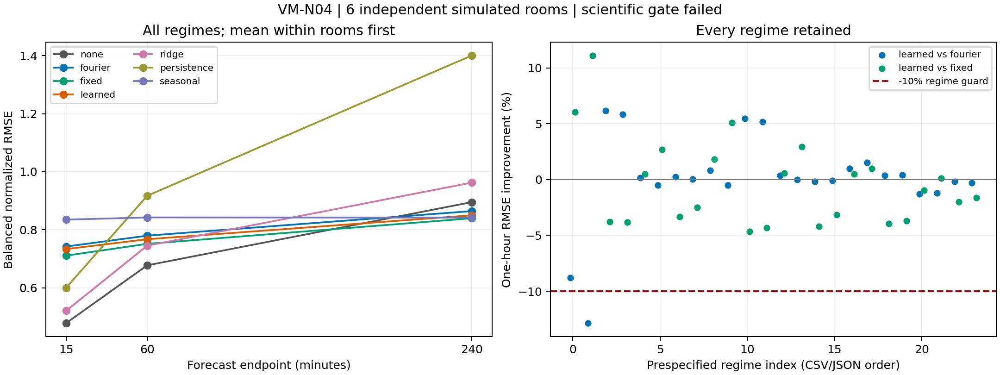

# VM-N04: circular forecasting under dynamics and changing routines

**Completed; the locked scientific gate failed.** Learned circular locality
did not add the required predictive value beyond both capable calendar
controls. At the primary one-hour endpoint, learned kernels improved balanced
normalized RMSE **1.58% over Fourier**, below the prespecified 5% minimum, and
were **2.10% worse than fixed kernels**. They also failed one Fourier-relative
regime guard. Calendar information helped with stable routines, but the
three-hour routine shift reversed that benefit. This is a conditional result
for the prespecified additive model, not proof that adaptive locality can never
help forecasting.

## Material Passport

- Origin Skill: academic-research-suite / experiment-agent
- Origin Mode: authorized implementation, run and descriptive validation
- Origin Date: 2026-09-22
- Verification Status: ANALYZED; complete confirmation, independent saved-checkpoint/prediction replay passed
- Version Label: scientific protocol v1, storage controller v1.1

## Question and interpretation boundary

This is a self-contained synthetic forecasting experiment, motivated by the
[controlled-comparison clock audit](controlled_comparison_results.md), the
[static-locality findings](vm_locality_v2_results.md), and the explicitly supplied
sibling first-order/sensor-timing context. The
[context receipt](vm_n04_context_receipt.json) identifies the inspected sources.
Historical occupancy-probability results are motivation, not evidence of
concentration forecasting performance.

The [prospective protocol](vm_n04_protocol_v1.md) and
[machine-readable configuration](../configs/vm_n04_v1.json) define 24 test
regimes: three response times crossed with regular/irregular attendance,
stable/shifted routine and complete/bounded-outage sensing. There are six
independent confirmation room draws, each with two paired neural initializations.
Four test interventions share each fitted training model; they are not additional
independent replicates. All four neural arms retain the same sensor MLP and
training budget; only their future-clock branch differs.

## Primary result and horizon errors

Each room/regime score averages its two initialization-specific RMSEs, normalized
by that trajectory's training-sensor SD. Regimes and then rooms receive equal
weight. Intervals resample the six complete rooms, retaining all their paired
conditions and initializations. They are descriptive percentile bootstrap
intervals with limited six-room precision.

| Learned-kernel contrast | Improvement | Paired 95% interval | >=5% practical effect | Every regime within 10% regression | Gate |
|---|---:|---:|---|---|---|
| Versus Fourier | +1.58% | +1.24% to +1.91% | Fail | Fail | Fail |
| Versus fixed kernels | -2.10% | -2.92% to -1.30% | Fail | Pass | Fail |

All six room-level aggregates favor learned over Fourier by 0.91–2.26%; all
six favor fixed over learned, whose relative regression ranges 0.91–3.55%.
Those consistent directions do not turn a sub-threshold effect into a practical
win. No individual regime achieved >=5% learned improvement against both
controls. The failed Fourier guard is the fastest response, regular stable
attendance **with outage**: normalized error increased 12.86%; mean ppm RMSE
was 16.30 versus Fourier's 14.30 and fixed kernels' 18.73. Retaining the failed
guard matters even though learned improved against the fixed bank there.

Below are balanced means of per-room/regime/initialization errors, not an RMSE
pooled over all correlated windows. Each endpoint is a distinct prediction;
the last column scores the complete 16-step forecast.

| Arm | 15-min RMSE ppm | 1-hour RMSE ppm | 1-hour MAE ppm | 4-hour RMSE ppm | Whole-horizon RMSE ppm |
|---|---:|---:|---:|---:|---:|
| Sensor-only MLP | 25.95 | 38.73 | 21.08 | 51.92 | 46.88 |
| Fourier calendar | 42.31 | 44.34 | 25.83 | 48.44 | 46.45 |
| Fixed kernels | 40.27 | 42.56 | 26.22 | 47.13 | 45.10 |
| Learned kernels | 41.63 | 43.43 | 25.77 | 47.50 | 45.61 |
| Sensor residual ridge | 28.16 | 42.26 | 25.67 | 54.12 | 49.22 |
| Persistence | 33.19 | 53.74 | 28.73 | 79.78 | 67.66 |
| Training seasonal mean | 46.77 | 47.29 | 27.39 | 47.23 | 47.25 |

At one hour, learned's normalized error was 13.26% higher than sensor-only MLP
and 2.98% higher than ridge; its skill was +16.32% against persistence and
+8.91% against seasonal. At four hours its skill was +5.07% against sensor-only,
+11.70% against ridge, +39.31% against persistence and -0.94% against seasonal.
The whole-horizon skill against sensor-only was only +0.27%. An aggregate over
horizons would conceal the strong short-horizon penalty.

The complete [672-cell table](vm_n04_cells_v1.csv) includes every regime and
arm at all three endpoints plus whole-horizon scores, RMSE/MAE, clean-target
diagnostics, reference-relative skills, room SD and nested initialization SD.
The [machine-readable results](vm_n04_results_v1.json) retain paired room
effects, gates, budgets and exact provenance. For example, learned one-hour
normalized RMSE is 0.76753, with room SD 0.01523 and mean within-room
initialization SD 0.00175; the latter is not six additional independent rooms.

## Where calendar information helps and fails

The table reports one-hour normalized RMSE, averaged over response times and
outage variants within each prespecified attendance/shift group.

| Routine / attendance | Sensor-only | Fourier | Fixed | Learned | Ridge | Persistence | Seasonal |
|---|---:|---:|---:|---:|---:|---:|---:|
| Stable / regular | 0.6701 | 0.2566 | 0.2689 | 0.2601 | 0.7492 | 0.9446 | 0.2412 |
| Stable / irregular | 0.6810 | 0.5181 | 0.5257 | 0.5204 | 0.7383 | 0.8803 | 0.6214 |
| Shifted / regular | 0.6769 | 1.3232 | 1.2184 | 1.2675 | 0.7509 | 0.9541 | 1.3070 |
| Shifted / irregular | 0.6826 | 1.0215 | 0.9938 | 1.0220 | 0.7430 | 0.8900 | 1.2010 |

Across stable conditions, learned reduces normalized error 42.23% against the
same sensor-only architecture; Fourier reduces it 42.66%. After routine shift,
learned increases it 68.42%, Fourier 72.47% and fixed kernels 62.73%. The
training seasonal reference is strongest in the stable/regular group. This
supports useful calendar information when routines persist, without establishing
an advantage specific to learned circular locality. The same calendar dependence
is brittle when the relation between clock and signal changes without retraining.

Physical smoothing changes the size of that dependence. Learned's stable
one-hour normalized errors are 0.3487, 0.3362 and 0.4860 at tau 0.5, 2 and 8
hours; sensor-only gives 0.7794, 0.6203 and 0.6271. Under shift, learned gives
1.2913, 1.1524 and 0.9905, versus sensor-only 0.7785, 0.6217 and 0.6390.
Slower dynamics reduce the shift penalty here, but do not remove it or establish
a learned-locality win. Noise constitutes a larger fraction of the slow
response signal; normalization does not remove that limitation.

Boundary diagnostics show the same reversal. Within one hour of actual attended
event onset/end, stable learned RMSE averages 28.37 ppm versus sensor-only
84.29; shifted learned RMSE is 128.49 versus 84.92. These realized-event masks
are descriptive scoring labels, not available forecasting inputs.

Outages are retained rather than filtered away. Averaged over other conditions,
learned normalized error moves from 0.7559 without outage to 0.7792 with outage;
sensor-only moves from 0.6250 to 0.7302. History-affected outage strata and
target-inside-outage strata are separately recorded in the cell table. This
bounded missingness result does not excuse the failed fastest-response guard.

The distinct clock diagnostic offsets future calendar inputs by +60 minutes
in stable/no-outage conditions, leaving physical forcing and sensors fixed.
Learned one-hour RMSE rises from 18.90 to 39.58 ppm; Fourier rises from 18.74 to
40.17, fixed from 19.21 to 37.54. Sensor-only remains 35.39. Applying the known
correction restores predictions within 1.08e-6 normalized units, consistent
with float32 roundoff. This is a sensitivity check, not a clock-estimation method
or a substitute for the actual routine-shift experiment.

## Acquisition and physical meaning

The generator uses a two-hour piecewise-constant daily equilibrium pulse and
the exact first-order update on a regular 15-minute UTC grid. Response times
are 0.5, 2 and 8 hours. Steady-state amplitude remains fixed across response
times, so this is a smoothing experiment, not an isolated airflow intervention.
Irregular attendance jointly changes presence, arrival jitter and amplitude.
The actual routine shift moves test forcing three hours later with correct
clocks; it is distinct from the intentional one-hour clock-encoding diagnostic.

The 56-day record is split 28/14/14 before normalization and windowing. The six
hour history contains sensor, availability mask and age. A measurement arrives
15 minutes after its event. Causal forward filling is limited to three hours;
all methods use the same eligible origins. The two-hour outages on three test
days keep every acquisition row. Hidden simulator target observations remain
available for offline scoring, including inside an outage.

The outcome is observed concentration in ppm, with 10 ppm observation-noise SD.
Clean latent errors are secondary diagnostics. The primary endpoint is one hour;
15-minute and four-hour endpoints are secondary. The whole-horizon score is the
square root of the mean squared error over all 16 targets, not the average of
16 endpoint RMSEs. Hourly issuance covers one of the four acquisition-grid origin
phases. Split-contained histories exclude the first six hours after a split,
so these results do not address the immediate onset of the test shift.

Every training cell has 662 eligible hourly origins, 10,592 overlapping target
uses and 2,660 unique target timestamps. Validation has 326 origins, 5,216 uses
and 1,316 unique targets; each test regime has the same counts. Each split
excludes six candidate origins for history and four for future horizon. No
scientific origin is excluded for stale/missing history or nonfinite targets,
including outages. Normalization and seasonal fitting can use all 2,687 training
observations received by its final event time; this slightly exceeds the unique
supervised target count and is disclosed as reference/normalization information.
Training SDs range 21.29–123.19 ppm, so the numerical 1 ppm floor is inactive.

## Engineering acceptance

The unchanged six-model standard synthetic benchmark passed and reproduced
base VM RMSE 5.35727 ppm and TemporalVM 5.33500 ppm. The separate adapter run
used its unchanged 90-day signal, 72-hour history, 12-hour horizon, 50-epoch
budget and original acceptance thresholds.

All four new neural arms passed absolute limits but failed the stricter base-VM
RMSE/MAE/MAPE regression gates. They remain **unvalidated** under this project's
model-acceptance rule. Ridge passed both gates. Scientific comparisons below do
not override this outcome. No arm was altered or retried to pass the standard
benchmark. The legacy standard calendar/DST limitation remains documented in
the adapter manifest; the new scientific generator uses consistent UTC clocks.

| Standard adapter | Parameters | RMSE ppm | MAE ppm | R2 | MAPE % | Acceptance |
|---|---:|---:|---:|---:|---:|---|
| Base VM | 43,148 | 5.3573 | 4.1508 | 0.97896 | 0.6916 | Pass |
| No calendar | 15,308 | 6.5438 | 5.1248 | 0.96861 | 0.8581 | Regression fail |
| Fourier | 15,341 | 6.4908 | 5.0786 | 0.96911 | 0.8501 | Regression fail |
| Fixed kernels | 15,341 | 6.4669 | 5.0628 | 0.96934 | 0.8475 | Regression fail |
| Learned kernels | 15,405 | 6.4825 | 5.0775 | 0.96919 | 0.8498 | Regression fail |
| Residual ridge | 5,196 | 5.1222 | 3.9787 | 0.98076 | 0.6608 | Pass |

Standard persistence RMSE was 52.1991 ppm; the training-hour seasonal reference
was 13.2330 ppm. These simple references have finite-only acceptance and their
poor errors remain visible. Standard-adapter parameter counts differ from the
smaller six-hour scientific models. Complete gates and check receipts are in
[the engineering record](vm_n04_engineering_v1.json).

The final full suite passed **1,465 tests in 81.49 seconds**, including CPU/CUDA shape,
dtype, finite output, gradient and actual calendar-boundary periodicity checks.
The final model/analysis supplement passed 134 tests in 4.16 seconds; storage
repair plus runner guards passed 19 in 5.65 seconds. These sets overlap and must
not be summed as independent tests. Checks cover exact integration, delayed
and out-of-order arrivals, unavailable-value mutations, split scopes, contiguous
grids, complete-bin availability, numerical ridge solves, validation selection,
source locks, incomplete stages and artifact mutation. The earlier pre-pilot
full suite passed 1,433 tests; the final rerun includes all added analysis and
storage-recovery tests. The original pre-confirmation proof is preserved.

## Execution record and storage recovery

Pilot used one new room and both prespecified learning rates; development used
two new rooms; confirmation used six reserved rooms. The pilot selected one
common Adam rate, **0.01**, from original validation losses (mean normalized MSE
0.33495 versus 0.35640 at 0.003). Each neural fit used 80 epochs; checkpoint
selection considered epoch zero and each fifth epoch on validation labels only.

The original pilot completed all 48 fits but failed during final JSON summary
writing on NumPy int32 metadata. The failed directory, first source lock and all
completed evidence were preserved. A separately locked storage-only controller
recovered exactly those fits, verified their inputs/predictions/metrics and made
no refits or test-based selections. See the
[explicit recovery record](vm_n04_storage_recovery_v1_1.md).

Original per-neural-fit timers survive. Original pilot reference timers and its
unflushed final monotonic timer do not. The access-to-last-artifact wall-clock
span was 43.547 seconds; adding a 60-second conservative allowance and 3.983
seconds of recovery work gave a feasibility estimate of 107.530 seconds. This
is an estimate with a safety allowance, not an exact recovered stage duration.
The unchanged 1.5 multiplier projected development/confirmation at
322.591/967.773 seconds, below their 900/1800-second caps. Development actually
completed all 96 fits in 85.521 seconds.

Confirmation completed **288/288 fits in 248.625 seconds**, within its unchanged
1,800-second cap. Across all stages, all **432 planned neural fits completed**,
with zero fit retries or omitted arms; the one finalization failure remains
explicit. Confirmation contains 1,152 neural and 432 reference prediction
records on 144 room/regime case bundles. No rate, endpoint, gate, seed or
scientific-source byte changed during development or confirmation.

Confirmation resource use: Python 3.11.4, PyTorch 2.5.1+cu121, NumPy 1.26.4,
pandas 2.3.3, CUDA 12.1, RTX 3060 Laptop GPU; CPU/BLAS threads one. Fits ran
serially. Peak PyTorch allocated GPU memory was 20,985,344 bytes (20.0 MiB);
this excludes CUDA context, allocator reserve and other desktop applications.
Host RSS was unavailable because optional psutil is not installed. An existing
marimo application was identified on the shared GPU; these are local elapsed
times, not dedicated-hardware latency guarantees.

| Scientific arm | Parameters | Unique fits | Median training seconds | Median inference ms / 326 origins |
|---|---:|---:|---:|---:|
| Sensor-only | 3,920 | 72 | 0.5700 | 0.705 |
| Fourier | 3,953 | 72 | 0.6851 | 0.926 |
| Fixed | 3,953 | 72 | 0.7199 | 1.030 |
| Learned | 4,017 | 72 | 0.8512 | 0.991 |
| Ridge | 1,168 | 36 | 0.0049 | 0.203 |
| Persistence | 0 | 36 reference instances | 0 | 0.042 |
| Seasonal | 96 | 36 | 0.0009 | 0.055 |

Inference includes tensor transfer and output transfer, excludes score/artifact
writing, and is synchronized for CUDA. Four test variants share each fit, so
training time is not multiplied by their evaluation count. Total neural fitting
time was 205.629 seconds; remaining stage time covers generation, evaluation,
diagnostics, preflight and evidence writes.

Independent CPU replay passed **52,663 checks**, including all 288 checkpoints,
1,584 prediction arrays, 144 case bundles and 2,342 artifact hashes. All 42,768
recomputed metric comparisons matched exactly. Maximum CPU/GPU prediction
difference was 2.30e-6 normalized units (0.000169 ppm), below the unchanged
1e-4 replay tolerance. Reference replay differed by at most 1.14e-13 ppm.
[The replay record](vm_n04_replay_v1.json) identifies its exact scope and hashes.
The statistical/claim [review](vm_n04_review_v1.md) separately checks the room
aggregation and interpretation; neither is an external human or blinded review.

## Scope and remaining uncertainty

Equal 32-feature calendar branches are not equal-parameter models: learning 32
centers and 32 concentrations adds 64 parameters. Fixed kappa is 32; Fourier has
16 harmonics. The calendar readout is additive and shared across horizons, with
no calendar–sensor interaction. Adam weight decay also applies to learned
geometry, so results condition on this optimizer and parameterization.

The outage follows the nominal routine clock and moves with its test shift;
it is independent of realized attendance/jitter but is not clock-independent
dropout. Its missingness pattern is an available sensor input. The diagnostic
label `origin_outage` means an outage anywhere in the six-hour history, not
necessarily missingness exactly at issuance. A three-hour fill bound preserves
these two-hour outages and does not establish safety for longer real outages.

Six rooms provide limited descriptive bootstrap precision. Overlapping targets,
multiple regimes and initialization seeds do not increase that independent
sample size. Training/validation and the standard benchmark are reused only
within their declared roles; published confirmation seeds are now consumed.
There is no building-population, deployment, novelty, LSTM-replacement, policy
or energy-saving claim. No real-data replication, uncertainty study or control
experiment was launched. Historical power-final evidence remains untouched.

## Reproduction and provenance

Use [the reproduction guide](vm_n04_usage.md). Full arrays, checkpoints,
per-fit validation histories and artifact hash inventories are local under
`results/vm_n04/study_v1_1/`; the original failed-finalization pilot remains under
`results/vm_n04/study_v1/`. These ignored results are absent from a fresh clone.

Inherited baseline: `a7431a926c751868b11a3918c6cdd29be6540a32`. The supplied
archive SHA256 `18191869b3383ee437e33de713b4aaed6a7f103e9ae88c5581ce8ea8a44f31b5`
and all 130 entries were verified. Matching worktree files stayed in place;
only the missing proposal was imported. Owner notes were not copied or changed.
No sibling checkout is a runtime dependency or was modified.

Original eight-source lock:
`35144cbadfced8c4f10ce6dc11d8a96195b8abdf10a99c9505959c65f140e7e9`.
Successor ten-source lock:
`069abf9d9635ef9c6b3345404e300f421ec81147997bca735cdeb5c029bd2d74`.
Every original scientific source byte matches both locks. The successor adds
only the serializer controller and its recovery contract.
The [compact run record](vm_n04_run_record_v1.json) preserves both source-lock
contents, configuration, stage receipts, standard metrics, validation evidence,
recovery details and artifact identities in a single tracked record.
