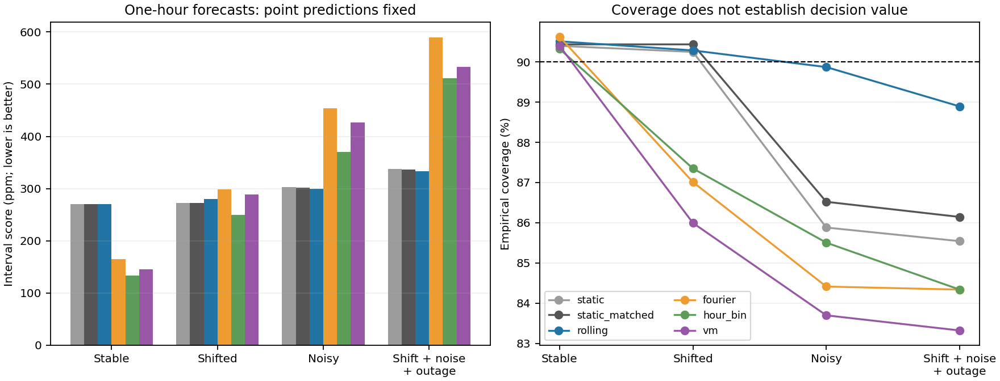

# VM-N05: uncertainty timing around a fixed persistence forecast

## Material Passport

- Origin Skill: academic-research-suite / experiment-agent
- Origin Mode: authorized implementation, run and descriptive validation; roles performed inline
- Origin Date: 2026-09-26
- Verification Status: ANALYZED; passing engineering tests and hash-verified saved artifacts, not an independent scientific replication
- Version Label: vm_n05_v1

## Completed result

**The prespecified scientific gate failed.** VM-conditioned scale calibration
reduced the balanced one-hour interval score **7.50% relative to Fourier**, but
the paired eight-room 95% bootstrap interval was **−4.34% to +17.43%**. Only four
of eight room effects favored VM. VM also missed the 85% empirical coverage
guard in both noisier conditions. Hour-bin conditioning and ordinary rolling
calibration had lower overall scores than VM. These outcomes complete the
bounded task; they do not justify selecting another horizon or replacing the
prespecified comparator after inspection.

The point forecast was **latest-arrived persistence**, chosen before N05 data
generation for its simple, eligible definition. It was bit-identical across all
six calibration arms at every matched issue/horizon. This delivery tests scalar
uncertainty calibration, not a new point predictor, learned kernel geometry,
LSTM replacement or controller. N04's scientific failure remains unchanged;
its four neural adapters remain unvalidated, while residual ridge retains its
previous passing acceptance. None was retrained or benchmarked here.

## What was frozen and run

The [protocol](vm_n05_protocol_v1.md), [configuration](../configs/vm_n05_v1.json)
and [source lock](vm_n05_source_lock_v1.json) were frozen before generating any
of the eight reserved N05 seeds. Each room contributes four paired conditions:
stable routine, a three-hour evaluation-only shift, evaluation-only noise SD
30 instead of 10 ppm, and shift plus noise plus three sensor outages. All use
the unchanged N04 first-order generator at response/event-duration ratio 1 and
regular attendance. The new noise extension changes only evaluation measurement
noise. Room draws, not the four interventions or overlapping rows, are independent.

The 56 days are partitioned into 14 days of point warm-up, 14 of scale fitting,
14 of calibration and 14 of evaluation. Persistence fits no parameters. At
15-minute, one-hour and four-hour horizons, three conditional arms fit log
absolute-error scale regressions with the same four causal sensor covariates,
24 future-clock features, one fixed penalty and no tuning trials. Fourier has
12 sine/cosine harmonics; hour-bin has 24 hourly indicators; VM has 24 fixed
centers with concentration 8. Each scale fit has 29 numerical coefficients,
including the intercept. Equal coefficient penalties do not equalize functional
regularization or effective degrees of freedom.

Each room has nine scale fits, reused across its four scenarios because their
pre-evaluation partitions are identical. **All 72 fits and 32 room/scenario
runs completed once**, without failed, dropped or retried formal fits. Each
scenario/horizon has 332 scored origins per room, 2,656 over eight rooms. There
are 31,872 matched issue/horizon cases across the paired scenarios and
**191,232 interval rows** across six arms. Those are not 191,232 replications.

## Scores, coverage and width

The following one-hour values average within room/scenario, equally across
four scenarios, then equally across eight rooms. Interval score and width are
in ppm; lower score is better. Every arm has the same 10,624 scoring cases at
this horizon, distributed across 32 paired room/scenario conditions.

| Calibration | Interval score | Coverage | Width | Lower miss | Upper miss |
| --- | ---: | ---: | ---: | ---: | ---: |
| Global static | 295.99 | 88.02% | 182.65 | 4.55% | 7.44% |
| Static, matched 168 errors | 295.43 | 88.38% | 187.20 | 4.25% | 7.36% |
| Delayed rolling, 168 errors | 295.92 | 89.89% | 199.72 | 3.36% | 6.75% |
| Fourier scale + rolling | 376.47 | 86.60% | 323.81 | 8.67% | 4.73% |
| Hour-bin scale + rolling | 316.39 | 86.88% | 253.81 | 8.04% | 5.08% |
| VM scale + rolling | 348.22 | 85.85% | 284.99 | 9.78% | 4.37% |

VM's score is **17.67% higher than ordinary rolling** and **10.06% higher than
hour bins** on this support. These are descriptive reference comparisons, not
alternative primary gates. Static and static-matched closely agree here. The
one-hour overall rolling/static score difference is very small, so this study
does not establish a general adaptation advantage. The matched static arm
removes the major pool-size difference but does not equalize historical time
span under missingness or make the old and current error distributions identical.

| Condition | Rolling score | Fourier score | Hour-bin score | VM score | VM coverage | VM/Fourier improvement |
| --- | ---: | ---: | ---: | ---: | ---: | ---: |
| Stable | 270.68 | 164.46 | 133.84 | 144.98 | 90.40% | 11.84% |
| Shifted | 279.89 | 298.40 | 249.71 | 288.78 | 85.99% | 3.23% |
| Noisy | 299.45 | 453.60 | 370.41 | 426.19 | 83.70% | 6.04% |
| Shift + noise + outage | 333.66 | 589.42 | 511.60 | 532.93 | 83.32% | 9.58% |

VM passes all four relative score-regression guards, but fails both noisy
coverage guards. Stable phase conditioning helps all three conditional methods
relative to unscaled rolling; the noisier conditions reverse that ordering.
Hour bins have lower one-hour scores than VM in every condition. The experiment
does not isolate the benefit of clock features from recent-change covariates
against unconditional arms, because both are added together; the VM/Fourier/
hour-bin comparisons do match that information.

| Calibration | 15-minute score | One-hour score | Four-hour score |
| --- | ---: | ---: | ---: |
| Global static | 211.82 | 295.99 | 444.71 |
| Static matched | 212.04 | 295.43 | 445.18 |
| Delayed rolling | 179.21 | 295.92 | 445.60 |
| Fourier | 224.67 | 376.47 | 772.71 |
| Hour bins | 215.19 | 316.39 | 552.20 |
| VM | 201.83 | 348.22 | 595.62 |

The [792-cell balanced table](vm_n05_comparison_v1.csv) includes every
scenario, arm, horizon and subgroup, with both miss rates, point errors and
counts. [All 6,336 room-level cells](vm_n05_cells_v1.csv) preserve variability,
empty groups and numerical flags. Point errors differ across scenarios but
never across calibration methods; intervals do not improve the point forecast.

## Timing of uncertainty and dependence

Recent rises are defined prospectively by an observed increase greater than
25 ppm over the preceding hour, known at issuance. In stable conditions there
are 299 rising origins across rooms: ordinary rolling coverage is **58.41%**,
versus **90.13%** for VM. Their scores are 542.67 and 407.57 ppm, while width
increases from 184.41 to 378.40 ppm. Hour bins score still lower (354.40), at
97.02% coverage. This local repair does not establish a specifically VM benefit.

Under noise, the same observed-rise rule also detects measurement fluctuations.
VM rise coverage drops to **75.62%**, with score 562.60 versus rolling's 336.37
and 83.53% coverage (775 origins). The rise label has remained causal and
unchanged; its meaning is conditional on sensor noise. Under shift plus noise
and outage, VM rise coverage is 73.49% and its score is 563.18, compared with
rolling's 82.88% and 350.15 (745 origins). These empirical cuts provide no
distribution-free conditional-coverage guarantee.

Target-clock reporting uses six four-hour bins. Across the four conditions,
VM one-hour coverage ranges from **77.46% at 16:00–20:00 UTC** to **95.87% at
08:00–12:00**. Rolling instead has 66.13% coverage at 12:00–16:00 and nearly
complete early-morning coverage. The methods redistribute width and misses
over time; a single overall coverage value hides that structure. The complete
phase and stale-sensor cuts remain in the tables, including empty stale-sensor
groups outside the outage condition.

The primary bootstrap resamples **complete independently fitted room pipelines**,
carrying every scenario/arm together. Room improvements range from −12.96% to
+27.92%; their sample SD is 15.85 percentage points. It measures joint room,
scale-fit and calibration variability, without identifying each variance source
separately. Eight rooms limit inferential precision and generator scope.

The separate, conditional two-day evaluation-block bootstrap gives a narrower
improvement interval, **+4.65% to +10.25%**. It holds fitted factors and issued
rolling quantiles fixed and omits their refitting variability. It must not
replace the **−4.34% to +17.43% primary room interval** or be presented as the
uncertainty of the complete calibration method. It also does not create extra
independent rooms from overlapping forecasts. This distinction materially
changes the apparent strength of the result.

## Delayed feedback, label budgets and numerical behavior

The ledger checks both target time and actual observation arrival. Arrivals
at issuance are processed before all forecasts at that instant. A historical
origin alone cannot make its target label eligible. Target/issue ordering,
rather than input row ordering, defines the latest pool. No outage observation
ever enters calibration, even though its simulator truth is retained for scoring.

At 15 minutes / one hour / four hours, each room has **336 / 335 / 332** eligible
scale-fit labels and the same respective initial static-calibration counts.
One one-hour and four four-hour forecast labels cross each fitting boundary
and are correctly excluded at that boundary. Scale-origin labels excluded at
day 28 never migrate into calibration. Unmatured calibration-origin labels can
join rolling pools later. There are **671 distinct target measurements** in
each of the disjoint scale-fit and initial calibration partitions; summing
horizon label uses instead gives 1,003. The three conditional arms reuse those
same labels rather than obtaining more labels per arm.

By the final issuance, online eligibility totals 667 / 666 / 663 residuals
per horizon without outages and 661 / 660 / 657 with outages; the current pool
always contains only the latest 168. Across horizons that is 1,333 versus
1,321 distinct target measurements. No arrived nonfinite labels were excluded
and no scored origin was removed for outage/stale history. The only history
exclusions are the first six hourly candidates; the final four hours have no
complete horizon. There are zero tuning labels and zero point-fitting labels.
Unconditional arms do not use scale labels, so their information budget differs
from conditional arms; the declared primary conditional comparison matches it.

The radius uses the actual one-based rank ceil((n+1)*0.9), with no interpolation.
Empty/tiny global pools would produce infinite intervals; focused tests exercise
that behavior. No such intervals or small-pool/phase fallbacks occurred in the
formal run. All scale fits and predicted scale values are finite and positive.

There were **11 scale-floor events and 54 scale-ceiling events among 95,616
conditional interval rows**. All floor events were VM one-hour predictions in
noisy conditions; their intervals were narrow (mean widths 22.28 and 26.06 ppm)
and had large miss penalties. All ceiling events were Fourier or hour-bin
predictions. Their average widths by affected cell ranged from 6,323 to 16,633
ppm. The maximum final width was **21,736.65 ppm**, for Fourier in a shifted,
noisy outage case. That large width is retained: the 1,000 ppm factor ceiling
does **not** cap final interval radius. These 65 rows contribute 1.79% of summed
conditional-arm scores across all horizons. [Clipping diagnostics](vm_n05_clipping_v1.csv)
describe their actual outputs, not an unrun unclipped counterfactual; clipping
can also influence future normalized pools. No width was truncated to improve
the recorded score, and no coverage theorem is claimed after clipping.

The log-scale regression can extrapolate strongly when observed changes move
outside its scale-fit range. Large widths in shifted/noisy conditions are
consistent with this mechanism, but no post hoc model change was made to repair
them. The scale-fit period has no outage variability, limiting what any arm can
learn about missingness despite all arms receiving those inputs.

## Engineering, provenance and scope

- **1,514 tests passed in 83.90 seconds**, including 49 N05 tests. Checks cover
  delayed arrivals, unavailable/future mutations, split-crossing labels, absent
  outage packets, target clock, wrap, positive scales, sparse/tiny pools,
  nonfinite inputs, metric/alignment failures and CPU/CUDA scale parity.
- The nonreserved final fixture took 2.88 seconds and projected 34.50 seconds
  with the prespecified 1.5 multiplier. The study took **21.95 seconds** against
  600; analysis took **6.93 seconds** against 120. Fits totaled 0.49 seconds;
  the remainder mainly constructs rows, issues intervals and writes artifacts.
  Peak torch-allocated GPU memory was 8,697,344 bytes. These counters exclude
  Python import/startup and tiny final manifest serialization overhead; the
  observed command wall times also remain well below their caps.
- Python 3.11.4, PyTorch 2.5.1+cu121, NumPy 1.26.4, pandas 2.3.3, CUDA 12.1,
  RTX 3060 Laptop GPU; one BLAS/torch thread. CUDA float64 was used for ridge
  solves, CPU NumPy for ledger/order statistics. No dependencies were installed.
- Lock SHA256: `468673446a1438bb0459c67bd0cd6f962568e7a69b76b1c141c140f0691311d6`.
  Config: `335e69f020a02e5f246a11c11f0c8f087533155980f9d2c9d3d15d634358f255`.
  Exact source identities, timing, environment, full label budgets and compact
  export hashes are in [the run record](vm_n05_run_record_v1.json).
- The 156-file dependency archive checksum and every member hash were verified.
  Its source revision `843bf96f289d6217b038ecbc2355eef4bf8b5e87` is a descendant
  of this worktree's initial `a7431a9` revision. Only the clean ancestor handoff
  differed; 127 matches were left intact and 28 files imported. The
  [dependency receipt](vm_n05_dependency_receipt.json) identifies inherited files
  separately. The N04 successor lock, ten corresponding sources in both trees
  and two selected engineering artifacts were hash-verified read-only.
- All original N04/v1/v2 scientific source/config bytes and owner notes remain
  unchanged. Only the assigned worktree was written. No historical predictions,
  confirmation seeds, raw real data, sibling campaign or N06 runtime were used.

The [reproduction and artifact guide](vm_n05_usage.md) documents the CLI and
[504-row portable interval sample](vm_n05_interval_contract_sample_v1.csv).
Actual arrival is empty for non-arriving packets, and offline scoring truth is
clearly marked. N06 can use just the point column; no interval dependence is
required. Raw arrays/factors and full interval CSVs remain under ignored
`results/vm_n05/study_v1/`. Compact results, tables, figure and source lock are
included under `docs/` for preservation with this delivery.

The supplied Chapter 5 lessons are retained as context: repair of rise coverage
did not automatically establish a preferable point predictor or decision gain.
This new study similarly supplies a bounded synthetic answer, with a failed
acceptance gate. There is no distribution-free conditional coverage claim, no
transfer of ACI guarantees, and no new controller, deployment or real-data result.

## Statistical interpretation check (11/11, inline)

| Check | Assessment |
| --- | --- |
| Simpson's paradox | Stable/noisy reversals and all scenario/phase cuts are shown; aggregate alone is insufficient. |
| Ecological fallacy | Room-level inference is not converted to per-origin or building-population guarantees. |
| Berkson selection | No outcome-based origin filtering or choice among successful rooms; fixed synthetic eligibility remains a scope limit. |
| Collider bias | Subgroups use origin-known measurements, not realized future attendance or target error. |
| Base rates | Coverage, both miss rates, group counts and widths are retained together. |
| Regression to the mean | Candidate/reference/gates were fixed before reserved access; no selection of worst rooms for claimed repair. |
| Survivorship | All eight rooms, four conditions, 72 fits and all arms retained; no failed formal fits. |
| Look-elsewhere | One primary comparator/horizon; all other comparisons descriptive, no multiplicity-adjusted discovery claim. |
| Forking paths | Exact source/config lock before generation; no tuned rate/geometry, refit or changed criterion after inspection. |
| Correlation/causation | Interventions are controlled within a synthetic generator; no claim about physical building causation. |
| Reverse causality | Explicit target/arrival ledger, origin-known features and mutation checks enforce the declared temporal direction. |

Interpretive confidence remains limited by eight independent rooms, the fixed
generator and changing conditions. This check was performed by the implementing
agent, not a blinded independent reviewer or external replication.
