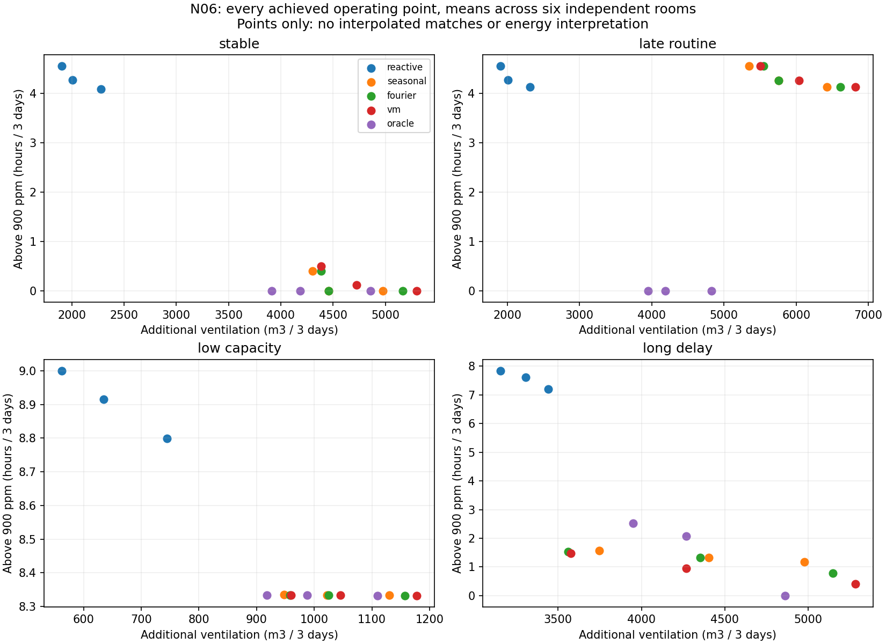
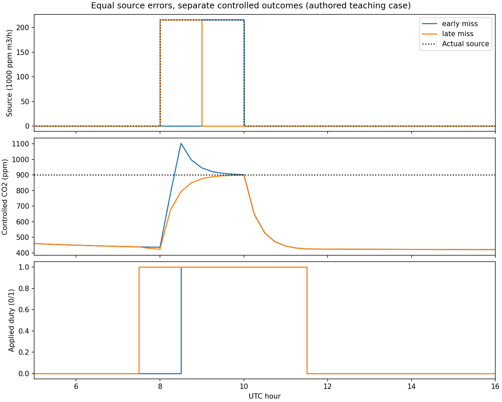

# N06 completion: useful forecast timing depends on the decision

The simulator, bounded comparison and offline demonstrator are complete. Under
the declared low effort penalty, anticipation improved outcomes relative to
reactive control in stable routines. A changed routine largely removed that
benefit, limited capacity prevented elimination of exceedance, and a higher
effort penalty favored reactive control. **The VM-specific practical-benefit
gate failed**: its improvement over Fourier was 2.73%, below the frozen 5%
minimum, with a paired interval crossing zero. This is a conditional synthetic
application result, not field validation or an adaptive-locality advantage.

Open [the demonstrator](vm_n06_demo/index.html), follow
[the guide](vm_n06_guide.md), or run `py -3.11 scripts/launch_vm_n06.py`.

## Scope and physical change

N04 varied a first-order response time while keeping equilibrium amplitude
fixed. N06 introduces a physical control input using
`V*dC/dt=S+Q*(Cout-C)`. Source generation is independent of the action; airflow
changes both decay and source equilibrium contribution. Integration is exact
within each constant fifteen-minute interval, with an explicit zero-flow limit.
Each policy evolves its own state and delayed noisy observations. The same
exogenous source and additive-noise draws pair the policies.

No N04 neural adapter was reused or retrained. The new VM source forecast uses
fixed kernels with a ridge readout and matched-information seasonal/Fourier
controls. There is no learned geometry or new neural architecture search.
N04's learned-kernel scientific gate remains failed: 1.58% improvement over
Fourier, 2.10% worse than fixed kernels, and one failed regime guard. Its four
neural adapters remain unvalidated after failed base-VM regression gates;
residual ridge passed both inherited checks. N06 does not upgrade those outcomes.

## Frozen comparison and measured completion

The [prospective contract](vm_n06_protocol_v1.md) and JSON were hashed before
development/evaluation generation. Implementation and analysis were then frozen.
Two independent development rooms selected each arm's margin from {0,100,200}
ppm; six new evaluation rooms each contributed three scoring days and four
paired regimes. Every room had a separate fourteen-day training source record.
Training has 1,344 ideal source labels per room; evaluation has 288 intervals.
Different days/regimes within a room are not additional independent units.

All **120 development and 360 evaluation rollouts** completed without a failed
fit, dropped arm or retry. Fits ran once per room/forecast arm: 24 source fits,
not 480 fits. Development took **2.15 s**, evaluation **5.99 s**, combined
**8.14 s**, below the 180-second cap. All margin candidates remain in the saved
matrix. Evaluation began only after development selection and engineering
evidence were bound into the evaluation lock.

Known quantities include volume, source-generation constant, outdoor level,
flow capacity and delays. Learned quantities are training calendar readouts;
tuned quantities are margins selected on development. Historical source labels
are an ideal synthetic counter assumption, not derived from concentration.
Realized future source is supplied only to the labeled oracle reference. It
uses the same heuristic, not an optimizer or mathematical performance bound.

## Outcomes and trade-offs

The primary objective is `J=exceedance h + 0.02*(extra air m3/1000)`. All arms
selected margin 200 ppm on development. Values below average three-day outcomes
equally across six rooms and four regimes. J variability is sample SD of the
six room-level means, keeping all regimes together.

| Policy | Above 900 ppm (h) | Severity (ppm*h) | Extra air (m3) | Starts | J mean ± room SD |
|---|---:|---:|---:|---:|---:|
| Reactive | 6.056 | 3100.4 | 2194.4 | 2.83 | 6.100 ± 1.128 |
| Seasonal | 3.409 | 1213.7 | 4378.9 | 3.71 | 3.496 ± 0.818 |
| Fourier | 3.312 | 1192.4 | 4520.8 | 3.71 | 3.403 ± 0.793 |
| VM fixed kernels | 3.217 | 1187.6 | 4643.9 | 3.71 | 3.310 ± 0.704 |
| Perfect-source oracle heuristic | 2.083 | 902.8 | 3914.1 | 2.83 | 2.161 ± 0.421 |

VM used over twice the extra airflow of reactive control at these operating
points. Its lower exceedance is not a matched-effort saving. The comparison is
the declared weighted objective, not a claim that one policy dominates all axes.

| VM contrast, primary objective | Relative improvement | Paired room 95% interval | Practical ≥5% | Every regime guard | Overall contrast |
|---|---:|---:|---|---|---|
| Reactive | +45.74% | +42.90% to +48.47% | Pass | Pass | Pass |
| Seasonal | +5.34% | +0.58% to +10.34% | Pass | Pass | Pass |
| Fourier | +2.73% | -0.07% to +6.15% | **Fail** | Pass | **Fail** |

The intervals use 2,000 paired bootstrap resamples of six complete rooms.
Their precision is limited. Every comparison had to pass; the Fourier failure
keeps the overall gate failed. Against Fourier, three room differences were
exactly zero, two favored VM, and one slightly favored Fourier. Fixed-kernel
readout behavior is not evidence for adaptive geometry.

The same primary settings give the following mean exceedance hours. The
[complete table](vm_n06_achieved_points_v1.csv) also retains effort, severity,
total flow, on-time, activations, switches and room SD for every margin.

| Regime | Reactive | Seasonal | Fourier | VM | Oracle |
|---|---:|---:|---:|---:|---:|
| Stable routine | 4.087 | 0.000 | 0.000 | 0.000 | 0.000 |
| Arrival three hours late | 4.130 | 4.124 | 4.124 | 4.124 | 0.000 |
| Limited extra capacity | 8.799 | 8.333 | 8.333 | 8.332 | 8.332 |
| Two-hour actuator delay | 7.206 | 1.177 | 0.792 | 0.411 | 0.000 |

After routine shift, the learned calendars continue to request early airflow,
then depend on feedback when attendance actually arrives. VM used 6,817.5 m3
extra versus reactive's 2,311.9 m3 for almost equal exceedance, so its primary
objective was 2.01% worse there. In the capacity-limited regime, even oracle
information left 8.332 hours above the threshold. The physical limit dominates.

The exact attained-mean-effort search found **one** VM/Fourier operating-point
pair in the stable regime: both at margin 0, both **4,387.5 m3** extra air.
VM exceeded the limit for **0.5024 h**, Fourier **0.4029 h**, so this match was
unfavorable to VM. It is a match of regime means, not per-room effort identity.
The other eleven regime/comparator combinations had no attained mean-effort
match. No interpolated or extrapolated crossing is used to make a favorable claim.

For `lambda=2`, development selected margin 0 for every arm. Mean J was **10.255**
reactive, **10.889** seasonal, **10.932** Fourier, **10.926** VM and **9.078** oracle.
VM's objective was 6.55% worse than reactive (improvement interval -13.33% to
+0.30%). The best non-oracle arm changed from VM to reactive. These are separate
development-selected operating points under two declared objectives. In the
viewer, a second illustration holds all primary settings fixed while changing
only the weight: it also reverses that non-oracle ranking.

## Three worked teaching cases

1. **Equal error, different timing.** Both authored source forecasts have MAE
   9,000 and RMSE 44,090.82 ppm*m3/h. Missing 08:00–09:00 gives 1.6617 h exceedance,
   83.16 ppm*h severity and 1,215 m3 extra airflow. Missing 09:00–10:00 gives zero
   exceedance and 1,620 m3. Same point-error summaries, different closed-loop
   consequences and effort. Neither forecast is claimed to come from a trained
   causal model. The separate authored margin menu retained the same best point
   under both weights; that null ranking change remains in the teaching JSON.
2. **Perfect information used poorly.** With normal capacity and 30-minute
   delay, reactive gives 1.7283 h exceedance, a 15-minute-lookahead oracle 1.6682 h,
   and a two-hour-lookahead oracle zero. With low capacity the latter still gives
   3.3050 h; with two-hour delay it gives 1.6617 h. Zero extra capacity makes all
   three curves identical at 6.6963 h. The oracle is a reference, not a bound.
3. **Change the objective.** The fixed-setting study view keeps physical points
   fixed and changes only their cost ranking. VM is preferred among non-oracle
   policies at lambda 0.02; reactive at 2. Labels distinguish this illustration
   from the study's separately selected secondary settings.

## Engineering acceptance and provenance

The required full suite passed **1,494 tests in 85.76 s**. The final N06 supplement
passed **32 tests in 1.49 s**, overlapping 29 full-suite tests and adding three
selection/analysis/teaching checks. These counts must not be summed. Checks cover
independent ODE integration, zero flow, semigroup identity, exact exposure units,
causal availability, future mutation, policy identity, capacity/delay, action
conditioning, scenario pairing, periodicity, shapes, finite gradients and CUDA
parity. No model or scientific pipeline code changed after the frozen run.

An additional [saved-rollout check](vm_n06_rollout_audit_v1.json) independently
recomputed all 103,680 evaluation transitions, delayed actions, observations,
capacity and effort measures. Maximum state difference was 7.96e-13 ppm.
Independent root finding and numerical quadrature on twenty rollouts agreed
with exact severity within 1.82e-12 ppm*h. This took 11.60 s and did not refit or
regenerate any trajectory. The static source figure was corrected by a separate
display-only renderer to show constant-interval steps; frozen analysis source
and all original data/plots remain preserved in the local run directory.

All three new calendar estimators were transferred to the unchanged standard
concentration dataset and scoring pipeline with one closed-form fit each. They
passed absolute thresholds but **failed base-VM regression**; none is called
validated. No model/gate was altered or retried. The inherited base VM metrics
were hash-verified before reuse; the unchanged model was not retrained.

| Calendar adapter | RMSE ppm | MAE ppm | R2 | MAPE % | Absolute | Base regression |
|---|---:|---:|---:|---:|---|---|
| Seasonal | 13.238 | 11.068 | 0.87152 | 1.8473 | Pass | Fail |
| Fourier | 13.234 | 11.079 | 0.87161 | 1.8492 | Pass | Fail |
| VM | 13.222 | 11.059 | 0.87183 | 1.8454 | Pass | Fail |

The standard diagnostic uses the original 90-day data, seed 42, chronological
80/10/10 split, 72-hour history and twelve-hour target windows. The source models
do not have a sensor branch or weekly term, and closed-form fitting has no
50-epoch optimization loop. This transfer failure cannot be turned into
closed-loop acceptance by the new synthetic study. The standard dataset's
historical local-calendar/DST limitation remains explicit.

Environment: Python 3.11.4, PyTorch 2.5.1+cu121, NumPy 1.26.4, CUDA 12.1, RTX 3060
Laptop GPU. Fits used float64 CUDA and one PyTorch CPU thread; simulation used
scalar CPU arithmetic. No global environment changes, external downloads or
services. Per-fit timers, every fitted readout, source/noise hashes, complete
arrays and code snapshots are in `results/vm_n06/study_v1/` in this worktree.

The archive SHA256 was verified against
`acc928bcc98bd9f7e38fcf496a26da757247344fd77fa3bc312064a90e5e31d7`.
All 156 entries were path-checked and individually verified: 127 matching files
left in place, 28 missing files added, one clean older project-state file updated,
zero conflicts. The [dependency receipt](vm_n06_dependency_receipt.json) separates
inherited files from N06 work. Inherited dependency commit: `c0ee369`; original
base: `a7431a926c751868b11a3918c6cdd29be6540a32`. Work branch:
`codex/vm-n06-decision-v1`. Owner notes remain byte-identical and untracked.
The [context receipt](vm_n06_context_receipt.json) records teaching-source hashes,
the validated read-only workspace and the selected historical standard artifact.
No historical prediction/checkpoint arrays were imported or reconstructed.

The [source lock](vm_n06_source_lock_v1.json),
[engineering record](vm_n06_engineering_v1.json),
[standard acceptance](vm_n06_standard_acceptance_v1.json),
[evaluation lock](vm_n06_evaluation_lock_v1.json),
[complete paired analysis](vm_n06_results_v1.json) and
[completion checks](vm_n06_completion_v1.json) preserve the evidence chain.
Only the current worktree's project-state addition changes an inherited document.

## Limits and stopping point

Six simulated rooms with ideal source labels cannot establish building-population
validity. The room is well mixed; outdoor concentration, airflow, volume and
generation are known exactly. There is no thermal model, actuation uncertainty,
occupant response, calibration uncertainty or imputation. The forecast models
ignore live source information and fail when routines shift. Calendar-only source
inputs avoid a controlled-sensor input shift, but do not prove suitability for
real feedback. The controller is a small fixed heuristic, not an MPC optimum.

The simulator scores the action-independent source separately from concentration
outcomes. It never scores unchanged open-loop concentration forecasts against
action-modified truth. No measured energy saving, health benefit, monetary saving,
novelty, universal superiority or model validation is claimed. N05 intervals,
real building data and deployment were not needed or used. The first-delivery
scope is complete; a new scientific comparison would need fresh trajectories
and a new prospective contract.
